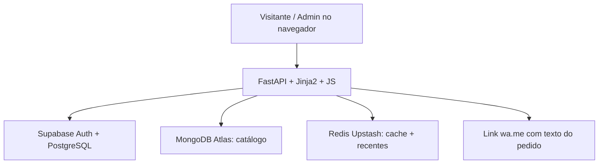

# NEOX drop — Documentação consolidada V1.1

**Acompanha pacote ZIP com diagramas SVG/PNG editáveis e PDF de apresentação.** Links de imagem relativos funcionam melhor na pasta completa do repositório.


---

## Arquivo: README.md

# NEOX drop — Documentação oficial V1

**Status:** documentação / pré-implementação  
**Versão:** 1.1 — 18/11/2026 (modelagem e diagramas)  
**Entrega acadêmica:** até **26/11/2026**, via Plataforma A  
**Trabalho:** 3ª Avaliação — Projeto de Banco de Dados Poliglota (6,0 pontos)  
**Autor(es):** preencher antes da entrega.

## O que é
NEOX drop é um protótipo acadêmico de e-commerce de tênis, com marca visual própria, catálogo, carrinho de compras e pedido via WhatsApp. O principal objetivo da avaliação é **demonstrar persistência poliglota real**, usando **Supabase Auth/PostgreSQL**, **MongoDB** e **Redis** de modo verificável.

> **Este repositório contém inicialmente a documentação do projeto.** Os comandos de execução só funcionarão após a implementação. Nenhuma integração, hospedagem ou teste está sendo apresentada aqui como já realizada.

## Decisões fixadas
- Backend em **Python + FastAPI**; páginas em **Jinja2**, **Tailwind CSS** e JavaScript simples.
- Supabase: login seguro de administradores, perfis e configurações da loja.
- MongoDB: produtos, tamanhos, preços, imagens e configuração de destaque da homepage.
- Redis: histórico recente por visitante + cache temporário de dados de produtos.
- Carrinho por sessão/navegador, com preços e disponibilidade **revalidados no backend**.
- Checkout gera `https://wa.me/<numero>?text=<mensagem-url-encoded>`; não processa pagamento nem envia a mensagem automaticamente.
- Hero: tênis 3D `.glb`, com giro 360° **ao redor do eixo vertical**, sem inclinação vertical, além de troca sincronizada de modelo, nome, preço e cores.
- Modelo 3D faltante: fotografia 2D sem falso giro; prioridade de implementação é comprovar **um modelo 3D real** no hero.
- Sem compras, contratação de serviços pagos ou deploy em produção sem aprovação.

## Mapa da documentação
| Documento | Objetivo |
|---|---|
| [00 — Contexto](docs/00-contexto.md) | Premissas, decisões e limites |
| [01 — Requisitos](docs/01-requisitos-prd.md) | PRD, regras e critérios de aceitação |
| [02 — Arquitetura](docs/02-arquitetura.md) | Componentes, fluxo e estrutura |
| [03 — Modelagem](docs/03-modelagem-bancos.md) | Supabase, MongoDB e Redis |
| [04 — API](docs/04-contratos-api.md) | Endpoints, formatos e erros |
| [05 — UX/UI](docs/05-identidade-ux-ui.md) | Identidade, telas e hero 3D |
| [06 — Segurança](docs/06-seguranca.md) | Autorização, CSRF, dados e riscos |
| [07 — Testes](docs/07-testes-qualidade.md) | Casos automatizados e demonstração |
| [08 — Ambiente e publicação](docs/08-ambiente-deploy.md) | Setup, variáveis e deploy condicional |
| [09 — Backlog](docs/09-backlog-agentes.md) | Tarefas, responsáveis e cronograma |
| [10 — Vídeo e entrega](docs/10-video-entrega.md) | Roteiro e checklist de submissão |
| [11 — ADRs](docs/11-adrs.md) | Registro das decisões técnicas |
| [12 — Rastreabilidade](docs/12-rastreabilidade.md) | Critério do enunciado → implementação → prova |
| [13 — Referências](docs/13-referencias.md) | Documentação oficial para consulta |
| [14 — Status](docs/14-checklist-execucao.md) | Estado inicial e evidências pendentes |
| [15 — Diagramas](docs/15-diagramas-modelagem.md) | 9 diagramas vetoriais + versões editáveis |
| [16 — Dicionário](docs/16-dicionario-de-dados.md) | Tipos, PK/FK, documentos e TTL |
| [17 — Esquemas físicos](docs/17-esquema-fisico-e-indices.md) | Validações SQL/Mongo, índices e consultas |
| [18 — Fluxos](docs/18-fluxos-e-consistencia.md) | Sequências e consistência entre bancos |
| [19 — Evidências DB](docs/19-matriz-evidencias-banco.md) | Demonstração e roteiro técnico |

## Pacote de modelagem V1.1
- [Galeria de diagramas SVG/PNG](docs/diagramas/README.md) e [DER Supabase](docs/diagramas/03-der-supabase.svg).
- [Caderno técnico dos diagramas em PDF](NEOX_drop_Caderno_Tecnico_Diagramas_V1_1.pdf), pronto para apresentação.
- [Migration SQL de referência](supabase/migrations/0001_schema.sql) e [validador/índices do MongoDB](mongo/001_products_schema_indexes.mongodb.js).
- [Contrato de chaves Redis](redis/README.md).
- Os diagramas e os scripts são **artefatos de projeto**, não comprovação de execução em bancos reais.

## Material dos agentes
- [AGENTS.md](AGENTS.md): instruções compartilhadas para Claude e Codex.
- [CLAUDE.md](CLAUDE.md): atribuições específicas do Claude.
- [.env.example](.env.example): **nomes** de variáveis, sem segredos.

## Condições para entregar
1. Login de administrador pelo Supabase exibido no vídeo.
2. Produto cadastrado no MongoDB e aparecendo imediatamente no catálogo público.
3. Redis realmente usado e demonstrável, incluindo TTL/cache.
4. Carrinho funcionando e link do WhatsApp gerando mensagem correta.
5. README final com passos reproduzíveis, código completo, scripts e vídeo de **5–10 minutos** com link acessível.

## Próxima etapa
Validar serviços e contratos; implementar *primeira fatia vertical*: login → cadastro real MongoDB → catálogo, antes de investir em refinamentos do hero 3D. Consultar [backlog](docs/09-backlog-agentes.md).


---

## Arquivo: AGENTS.md

# AGENTS.md — Regras compartilhadas Claude / Codex

## Missão
Construir NEOX drop, loja acadêmica de sneakers, conforme README.md e documentação de `docs/`. **Prazo de entrega: 26/11/2026.** Não afirmar que uma integração funciona sem teste.

## Prioridade inegociável
Supabase login admin; MongoDB CRUD/catálogo imediato; Redis recentes/cache; carrinho + revalidação do preço; WhatsApp; vídeo 5–10 minutos. Depois: hero 3D e acabamento.

## Stack
Python/FastAPI + Jinja2 + Tailwind CSS + JavaScript + `<model-viewer>`; Supabase Auth/Postgres, MongoDB, Redis Upstash.

## Instruções
1. Antes de modificar algo, inspecionar os arquivos e confirmar estado real.
2. Ler `docs/01-requisitos-prd.md`, `docs/04-contratos-api.md` e arquivo da área pertinente.
3. Não alterar nomes e formatos de endpoints unilateralmente.
4. Não inserir senhas, tokens, números pessoais, URIs reais em Git.
5. Não criar deploy, gastos, compras, contas, migrações destrutivas, exclusões ou alterações remotas sem autorização.
6. Não atribuir privilégios administrativos a todo usuário autenticado.
7. Nunca aceitar preços do browser; montar pedido no backend com MongoDB como fonte da verdade.
8. Manter testes e documentação sincronizados com código real.
9. Usar branches ou worktrees distintos: `feature/frontend` Claude e `feature/backend` Codex; `main` só por merge revisado.
10. Não usar skills de segurança como desculpa para executar varreduras contra serviços externos sem permissão; testes somente ambiente próprio/controlado.
11. Respeitar visual aprovado: marca **NEOX** principal, `drop` secundária, esportivo editorial, hero com carrossel e **giro do modelo real 3D somente no eixo Y**; fallback estático.
12. Evitar overengineering; manter backlog P0 antes de P1.

## Responsáveis
- **Claude:** UX/UI, templates, CSS, JS, acessibilidade, visualizador 3D e testes de interação.
- **Codex:** FastAPI, DB, schemas, migrations, autenticação, segurança, checkout e testes.
- **Humano:** aprova decisões de custo, publicação, infraestrutura, credenciais e merges.

## Comprovação de conclusão
Descrever o que mudou, comandos executados, testes que passaram/falharam, limitações, arquivos modificados e próxima tarefa. Nunca declarar "pronto" sem evidência.

## Modelagem V1.1 — fonte de verdade
Antes de alterar banco, payload, queries ou autorizacao, conferir `docs/15-diagramas-modelagem.md`, `docs/16-dicionario-de-dados.md`, `docs/17-esquema-fisico-e-indices.md` e `docs/18-fluxos-e-consistencia.md`. Se mudar um campo ou indice, atualizar diagramas e exemplos no mesmo commit. Nao tratar diagramas como evidencias de implementacao.


---

## Arquivo: CLAUDE.md

# CLAUDE.md — Guia do Claude Code (NEOX drop)

Siga obrigatoriamente `AGENTS.md` e os documentos de `docs/`. **Não reinvente a stack:** a aplicação é **Python + FastAPI + Jinja2**, com JS apenas para interatividade.

## Seu foco
- Transformar o mockup aprovado em componentes Jinja2 + Tailwind CSS.
- Identidade NEOX drop: `NEOX` dominante, itálico esportivo, `drop` coral, cabeçalho preto, off-white, verde-lima em interações e cards Street/Classics/Performance.
- Home editorial, catálogo, produto, carrinho e painel. Contrato com backend em `docs/04-contratos-api.md`.
- Hero 3D: carregar um GLB real licenciado, camera-orbit com ângulo polar fixo, azimute livre, arraste horizontal, auto-rotação lenta, `prefers-reduced-motion`, poster/fallback. Trocar nome, preço, modelo e fundo em uma transição sincronizada.
- Responsividade, foco visível, labels, feedback de erro/loading.

## Restrições
- Não criar backend Node/Next.js paralelo, nem prometer frete, parcelamento ou pagamento real.
- Não modificar serviços Python/SQL/Mongo/Redis sem alinhamento com Codex.
- Não copiar logos ou imagens de outros sites sem licença.
- Trabalhar em branch/worktree próprio. Testes visuais com dados fictícios até contrato real estar disponível.

## Ferramentas opcionais
UI UX Pro Max pode ajudar a sistematizar o design. Serena ajuda a navegar códigos; Superpowers em implementação disciplinada; Spec Kit só como apoio às especificações já fixadas. Qualquer instalação/hook/MCP deve ser previamente revisado.

## Entrega de cada tarefa
Resumo, arquivos, screenshots ou passos reprodutíveis de teste, bugs conhecidos e próximos passos. Não indicar sistema funcional antes de testar contra backend real.


---

## Arquivo: docs/00-contexto.md

# 00 — Contexto, premissas e decisões

## Origem e objetivo
Trabalho da **3ª Avaliação — Projeto de Banco de Dados**, valor **6,0 pontos**, individual ou dupla, entrega até **26/11/2026** na Plataforma A. Tema proposto: e-commerce/catálogo com arquitetura de banco de dados poliglota e interface gráfica obrigatória. O professor exige Supabase, MongoDB, Redis, carrinho e compra via WhatsApp, além de GitHub e vídeo de 5–10 minutos.

## Decisões da NEOX drop
- Nicho: tênis/sneakers (substitui proposta antiga de eletrônicos).
- Nome completo: **NEOX drop**; **NEOX** é o elemento tipográfico protagonista, **drop** é assinatura secundária.
- Direção aprovada: visual esportivo editorial premium; imagens de tênis grandes, cartões coloridos, espaços claros, preto, off-white, coral e toques de verde-lima. Hero com tênis flutuante e carrossel de destaques.
- Interação distintiva: seletor de sneakers atualiza o tênis, o fundo, o nome, o preço e o texto; **modelo 3D gira apenas ao redor do eixo vertical** (arraste horizontal em mouse/touch; animação suave opcional).
- Stack definida: Python/FastAPI + Jinja2 + Tailwind + JavaScript + `<model-viewer>`; Supabase Auth/PostgreSQL, MongoDB Atlas, Redis/Upstash.
- Publicação: preferencialmente online, **condicionada** a compatibilidade, segurança e planos sem custos; a execução local é contingência válida.
- Desenvolvimento por IA: Claude (UI/UX) e Codex (Python/bancos/testes), trabalhando em áreas/branches separadas; skills opcionais controladas.

## Prioridades
- **P0 — exigido para avaliação:** login, CRUD de produto, atualização visível no catálogo, Redis, carrinho, WhatsApp, repositório, vídeo.
- **P1 — identidade e diferenciação:** hero 3D com pelo menos um `.glb` verdadeiro, carrossel sincronizado, responsividade e acessibilidade.
- **P2 — fora da primeira versão:** pagamento integrado, frete real, pedido confirmado, estoque reservado, conta de cliente, upload de mídia complexo, IA, integrações com catálogo real de marcas, analytics e backoffice avançado.

## Assunções explícitas
1. O sistema é uma **demonstração acadêmica**, sem transações comerciais reais.
2. A loja trabalha com BRL, português do Brasil e numeração brasileira de calçados.
3. Clientes **não fazem login**; somente administradores são autenticados.
4. O catálogo usará ativos de mídia próprios, gratuitos com licença ou demonstrativos; não assumir direito de uso de qualquer fotografia/logotipo de terceiros.
5. A publicação depende de contas e variáveis de ambiente que ainda deverão ser configuradas.
6. Os preços dos exemplos são fictícios; números/WhatsApp real não serão inventados.

## Glossário
**Hero:** área principal da página inicial; **drop:** coleção/lançamento; **SKU:** código único do produto; **slug:** parte legível da URL; **cache:** cópia temporária de dados; **RLS:** políticas de acesso por linha; **soft-delete:** desativação sem apagar definitivamente; **GLB:** formato de modelo 3D; **P0/P1/P2:** prioridade de implementação.


---

## Arquivo: docs/01-requisitos-prd.md

# 01 — PRD, requisitos funcionais e critérios de aceitação

## Problema
Demonstrar uma loja de sneakers que **usa três tipos de persistência** para tarefas distintas, com navegação comercial convincente, administração segura e compra simplificada via WhatsApp.

## Perfis
- **Visitante público:** vê produtos, filtra, consulta tamanhos, usa recentes, adiciona/remover carrinho e abre link do pedido.
- **Administrador autorizado:** autentica por Supabase, gerencia produtos MongoDB e configura destaques/contato da loja.

## Requisitos funcionais (RF)
| ID | Requisito | Pri. | Aceitação observável |
|---|---|---|---|
| RF-01 | Login/logout de admin via Supabase Auth | P0 | Conta válida entra; inválida não; logout encerra sessão |
| RF-02 | Verificação de perfil `admin` ativo | P0 | Usuário autenticado sem perfil ativo recebe 403 |
| RF-03 | Criar produto no MongoDB | P0 | Novo produto persiste e recebe ID/slug únicos |
| RF-04 | Editar/desativar produto | P0 | Alterações persistem; desativado some do catálogo público |
| RF-05 | Catálogo público MongoDB | P0 | Novos produtos aparecem após criação sem exigir redeploy |
| RF-06 | Página de produto com numeração/preço | P0 | Mostra tamanho, disponibilidade e informações coerentes |
| RF-07 | Carrinho adicionar/remover/quantidades | P0 | Total e quantidade mudam corretamente |
| RF-08 | Checkout via WhatsApp | P0 | Link abre destinatário configurado com itens, tamanhos, quantidade e total formatados |
| RF-09 | Histórico de vistos recentemente no Redis | P0 | Últimos cinco visitados são recuperados na ordem correta, com TTL |
| RF-10 | Cache Redis de detalhes de produtos | P0 | Cache-hit e invalidação após edição demonstráveis |
| RF-11 | Home com marca NEOX drop | P1 | Visual alinhado à identidade aprovada |
| RF-12 | Carrossel de destaques sincronizado | P1 | Troca de produto altera foto/modelo, nome, preço e fundo |
| RF-13 | Visualizador 3D eixo vertical | P1 | Modelo real `.glb`, rotação 360° horizontal, sem inclinação de cima/baixo |
| RF-14 | Busca/filtros por marca/categoria/tamanho | P1 | Filtros refletem documentos do MongoDB |
| RF-15 | Responsividade + acessibilidade | P1 | Teclado, mobile, foco visível e redução de animações |
| RF-16 | Administração dos destaques e da cor | P1 | Mudança no MongoDB repercute no hero sem editar código |

## Regras de negócio (RN)
- RN-01: preço persistido em **centavos inteiros** (`priceCents >= 0`), convertido para moeda BRL só na apresentação.
- RN-02: um item de carrinho é identificado por **produto + tamanho BR**; quantidades inteiras de 1 até limite configurado, com máximo de 10 unidades por linha na V1.
- RN-03: produto `active=false` ou numeração sem estoque não pode ser usado para gerar pedido válido.
- RN-04: cliente envia IDs, tamanho e quantidades; **backend busca preços/estoque atualizados no MongoDB**; não aceita `priceCents` do cliente.
- RN-05: botão **Finalizar pelo WhatsApp** cria mensagem e link; sem confirmação de pagamento, envio ou reserva de estoque.
- RN-06: criar/editar produto invalida cache Redis por ID e, conforme estratégia, cache de listagem; lista pública deve atualizar na próxima consulta.
- RN-07: histórico recente limita a 5 IDs, remove duplicações e expira após 7 dias; produtos removidos são ignorados ao renderizar.
- RN-08: modelos 3D são opcionais por produto; se indisponíveis, hero usa imagem 2D. Não simular giro 3D com foto única.
- RN-09: conta de admin criada por processo controlado; não existe cadastro administrativo público.
- RN-10: a aplicação roda com registros de produtos fictícios e não publica dados pessoais de clientes.

## Requisitos não funcionais (RNF)
- RNF-01: **segurança:** HTTPS em hospedagem, sessões HttpOnly/Secure, CSRF, rate limit e validações no backend.
- RNF-02: **performance:** imagens otimizadas; lazy-load dos modelos 3D; carregamento inicial não deve depender de assets 3D pesados.
- RNF-03: **disponibilidade:** queda de Redis não derruba catálogo/checkout; o recurso de recentes pode se degradar.
- RNF-04: **observabilidade:** logs estruturados de falhas sem tokens, senhas ou dados sensíveis.
- RNF-05: **qualidade:** testes de rota/API, integração real dos 3 bancos em ambiente controlado e checklist manual do vídeo.
- RNF-06: **manutenibilidade:** código tipado, serviços desacoplados por camada, documentação reproduzível.
- RNF-07: **acessibilidade:** textos em português claro, labels, contraste adequado e opção `prefers-reduced-motion`.

## Fora de escopo
Pagamento por cartão/Pix, logística/frete real, cupons sofisticados, cadastro de usuários compradores, emissão fiscal, estoque transacional/reserva, chat com IA, integração oficial WhatsApp Cloud API, painel de indicadores financeiro, uploads arbitrários sem pipeline seguro.

## Definition of Done geral
Uma feature só é concluída após: requisitos respeitados, code review, testes automatizados pertinentes, evidência manual quando aplicável, sem segredos no commit e documentação atualizada. Veja [07 — testes](07-testes-qualidade.md).


---

## Arquivo: docs/02-arquitetura.md

# 02 — Arquitetura de software

## Estilo
**Monólito modular Python-first:** FastAPI serve páginas Jinja2 e endpoints JSON. Tailwind é compilado para CSS estático; JavaScript controla carrinho, carrossel e `<model-viewer>`. Três bancos gerenciados têm responsabilidades distintas.



## Componentes
| Componente | Responsabilidade | Não deve fazer |
|---|---|---|
| Templates | Montar HTML e UI | Acessar bancos, confiar em preços do navegador |
| Frontend JS | Interações, carrinho local e 3D | Possuir chaves de banco, autorizar admin |
| API pública | Consulta, recente, checkout | Retornar campos internos/segredos |
| API admin | Autenticação, autorização, CRUD | Permitir acesso apenas por ocultar botão |
| Serviço de catálogo | Validar/normalizar produtos, índices/queries | Construir HTML |
| Serviço de checkout | Reconsultar produtos/preços/estoque e URL | Marcar pagamento como concluído |
| Adapters DB | Abstrair Supabase/MongoDB/Redis | Conter lógica de UI |

## Fluxos
### Cliente — catálogo
`GET /` → destaque MongoDB → render Jinja2 → `GET /api/products` para filtros, quando necessário → detalhe → Redis para recente. Redis retorna IDs; produtos completos vêm do MongoDB ou de cache com TTL.

### Admin — cadastro e atualização imediata
`/admin/login` → Supabase Auth → token/cookie seguro → checagem `admin_profiles.is_active` → `POST /api/admin/products` → MongoDB → invalidação Redis → catálogo renderiza a nova versão na próxima consulta, sem ISR/cache de HTML estático.

### Cliente — checkout
Carrinho guarda somente `{productId, sizeBR, quantity}` no browser (localStorage com esquema validado, ou memória). `POST /api/checkout` revalida produtos ativos, preço e estoque no MongoDB, retorna `waUrl` e resumo do servidor. O navegador abre `waUrl`. Não se registra pedido confirmado.

## Estrutura prevista
```text
neox-drop/
├── app/
│   ├── main.py
│   ├── core/{config.py,security.py,exceptions.py}
│   ├── api/{auth.py,products.py,recent.py,checkout.py,admin_products.py}
│   ├── services/{catalog.py,recent.py,cart.py,admin.py}
│   ├── db/{supabase.py,mongodb.py,redis.py}
│   ├── schemas/{product.py,checkout.py,auth.py}
│   ├── templates/{base.html,home.html,catalog.html,product.html,admin/}
│   └── static/{css/,js/,images/,models/}
├── supabase/migrations/
├── scripts/{seed_products.py,check_connections.py}
├── tests/{unit/,integration/,e2e/}
├── docs/
├── AGENTS.md
├── CLAUDE.md
├── .env.example
├── pyproject.toml
├── package.json
└── README.md
```
A estrutura é **planejada**, não evidencia arquivos de código já existentes.

## Decisões de implementação
- FastAPI com routers separados (`/api` público e `/api/admin`).
- Jinja2 para HTML inicial com carregamento progressivo; não introduzir SPA/React sem necessidade.
- `pymongo.AsyncMongoClient` para consultas assíncronas (ou driver síncrono isolado caso a equipe prefira simplicidade e demonstre ausência de bloqueio).
- `upstash-redis` sobre REST para facilitar função serverless; instância Redis exclusivamente do backend.
- `supabase-py` para auth e consultas SQL via API Supabase; evitar compartilhar sessão mutável de usuário entre requisições.
- `<model-viewer>` para 3D; `GLB` como recurso estático **licensed**; caso o modelo não exista, imagem 2D.
- API usa Pydantic para validação; Tailwind compilado no build (não depender do CDN de desenvolvimento).
- Configurações operacionais por variáveis de ambiente; não armazenar segredos no Git.

## Restrições e trade-offs
- Usar três bancos aumenta pontos de falha. Mantenha Redis como recurso auxiliar (fail-open para catálogo).
- Páginas renderizadas no servidor simplificam Python-first, mas transições e 3D exigem JS específico.
- Hospedagem serverless exige atenção a tempo de inicialização, tamanho dos assets, conexão MongoDB e lista de IPs do Atlas.
- Mudança de produto no carrossel: estados visuais devem ser sincronizados em uma única estrutura no frontend (não buscar cada campo separadamente).

## Referências oficiais
FastAPI templates: https://fastapi.tiangolo.com/advanced/templates/  
PyMongo Async: https://www.mongodb.com/docs/languages/python/pymongo-driver/current/  
Upstash Python SDK: https://upstash.com/docs/redis/sdks/py/overview/  
Model Viewer: https://modelviewer.dev/docs/  
Vercel FastAPI: https://vercel.com/docs/frameworks/backend/fastapi


---

## Arquivo: docs/03-modelagem-bancos.md

# 03 — Modelagem de dados: Supabase, MongoDB, Redis

## 1. Supabase Auth + PostgreSQL
O Supabase Auth gerencia os registros em `auth.users`; a aplicação mantém:

### `public.admin_profiles`
| Campo | Tipo | Restrição |
|---|---|---|
| `user_id` | UUID | PK, FK `auth.users.id` ON DELETE CASCADE |
| `display_name` | TEXT | NOT NULL |
| `role` | TEXT | `CHECK(role IN ('admin'))`, V1 apenas admin |
| `is_active` | BOOLEAN | NOT NULL DEFAULT false |
| `created_at` | TIMESTAMPTZ | DEFAULT now() |
| `updated_at` | TIMESTAMPTZ | DEFAULT now() |

### `public.store_settings`
| Campo | Tipo | Restrição |
|---|---|---|
| `id` | INTEGER | PK, `CHECK(id=1)` para loja única |
| `store_name` | TEXT | DEFAULT 'NEOX drop' |
| `whatsapp_e164_digits` | TEXT | Apenas dígitos, tamanho validado; sem número falso |
| `updated_at` | TIMESTAMPTZ | DEFAULT now() |

### Script SQL de referência (revisar antes de executar)
```sql
create table if not exists public.admin_profiles (
  user_id uuid primary key references auth.users(id) on delete cascade,
  display_name text not null,
  role text not null default 'admin' check (role in ('admin')),
  is_active boolean not null default false,
  created_at timestamptz not null default now(),
  updated_at timestamptz not null default now()
);
create table if not exists public.store_settings (
  id integer primary key default 1 check (id=1),
  store_name text not null default 'NEOX drop',
  whatsapp_e164_digits text not null default '',
  updated_at timestamptz not null default now()
);
alter table public.admin_profiles enable row level security;
alter table public.store_settings enable row level security;
-- Políticas e GRANTs devem ser criados e testados separadamente.
-- Não criar política pública de escrita. Não abrir cadastro de administradores.
```

**RLS:** negar acesso não autorizado por padrão. Para operações do admin, validar Auth token e admin ativo; políticas podem permitir ao próprio admin ler somente seu perfil. Se o backend usar secret/service role (que *bypassa RLS*), a autorização obrigatória ocorre **antes de toda consulta ou mutação**, sem exceções. Nunca confiar apenas em `role` enviado pelo browser. Primeiro administrador será provisionado manualmente em operação controlada.

## 2. MongoDB Atlas — `neox_drop.products`
Documento **exemplar** (ObjectId real, datas BSON e URLs deverão ser gerados/validados na implementação):
```json
{
  "_id": "ObjectId",
  "sku": "NEOX-NX001-PT",
  "slug": "runner-preto-lima",
  "name": "Runner Preto/Lima",
  "brand": "Marca Demonstrativa",
  "category": "Performance",
  "description": "Tênis de demonstração acadêmica",
  "priceCents": 89990,
  "currency": "BRL",
  "active": true,
  "mainImageUrl": "/static/images/runner-preto-lima.webp",
  "galleryUrls": ["/static/images/runner-preto-lima.webp"],
  "model3dUrl": "/static/models/runner-preto-lima.glb",
  "colorName": "Preto e verde-lima",
  "sizes": [{"sizeBR": 39, "stock": 3}, {"sizeBR": 40, "stock": 6}],
  "attributes": {"material": "Têxtil", "style": "Lifestyle"},
  "featured": {"enabled": true, "order": 1, "backgroundHex": "#191919", "accentHex": "#BDF400"},
  "createdAt": "Data BSON UTC",
  "updatedAt": "Data BSON UTC"
}
```

**V1 deliberadamente simples:** uma cor por documento. Outras cores podem ser outros produtos, em vez de introduzir catálogo de variantes complexo. `model3dUrl` é opcional, assim como `attributes`.

### Restrições e índices
- `sku`: obrigatório e único (`unique index`).
- `slug`: obrigatório e único; ideal para URL.
- `priceCents`: inteiro >= 0; `sizes[*].stock` inteiro >= 0; sem preços em float.
- `active`: boolean; catálogo público usa `active=true`.
- Índice `{active:1, category:1, createdAt:-1}` para filtros, `{active:1, 'featured.enabled':1, 'featured.order':1}` para destaque.
- Busca textual simples: índice textual apropriado em `name`, `brand`, `description`, ou regex controlada com limites; escolher após medir dataset.
- `ObjectId` do MongoDB serializado para `id` string na API; **não expor `_id` BSON bruto**.
- `updatedAt` sempre atualizado em edições; **soft-delete** altera `active=false`.

## 3. Redis Upstash
| Chave | Tipo | TTL | Finalidade |
|---|---|---|---|
| `recent:visitor:{opaqueId}` | LIST | 604800 s (7 d) | Últimos 5 IDs de produtos únicos |
| `cache:product:{productId}` | STRING/JSON | 300 s | Detalhe público de produto válido |

### Algoritmo de recentes
1. Cookie anônimo aleatório (ID opaco) identifica a sessão; não coletar nome/telefone.
2. Quando usuário abre página de produto: `LREM` do ID anterior → `LPUSH` novo ID → `LTRIM` 0..4 → `EXPIRE` 604800; se possível agrupar atomicamente numa transação/pipeline ou script compatível.
3. `GET /api/recent`: ler IDs, consultar produtos ativos no Mongo/cache preservando ordem, ignorar IDs inválidos.
4. Se Redis falhar: retornar lista vazia/indisponível e registrar erro, sem impedir navegação.

### Cache de produto
Cache-aside: `GET` primeiro lê Redis, no miss busca MongoDB e grava com TTL de 300s; `PATCH/DELETE` **invalida** `cache:product:{id}`. Nunca gravar perfil de admin, senhas ou credenciais no cache de catálogo. Não servir documentos admin/inativos por cache público após desativação; idealmente preencher apenas produtos ativos e invalidar sempre após mutações.

## 4. Demonstração poliglota
- Supabase: exibir autenticação e registro de perfil admin (sem credenciais).
- MongoDB: cadastrar tênis no painel e verificar documento persistido.
- Redis: visitar 2–3 produtos, voltar a “Vistos recentemente”, mostrar ordem/TTL e um cache-hit/invalidação no log de diagnóstico **sem revelar chaves**.

## Consistência
Não existem transações distribuídas entre os três bancos. No checkout, **MongoDB é a fonte da verdade** para preço e estoque; Redis é eventual/descartável. A V1 não decrementa estoque nem registra pedido confirmado.


## Diagramas e esquema fisico (atualizacao V1.1)
Para a apresentação profissional da modelagem, consultar:
- [15 — Diagramas oficiais](15-diagramas-modelagem.md): conceitual, DER relacional, estrutura MongoDB, modelo Redis e sequências.
- [16 — Dicionário de dados](16-dicionario-de-dados.md): atributos, PK, FK, tipos BSON, cardinalidades, validade e TTL.
- [17 — Esquemas físicos e índices](17-esquema-fisico-e-indices.md): matriz consulta × índice e scripts versionados.
- [18 — Fluxos e consistência](18-fluxos-e-consistencia.md): regras e falhas parciais entre bancos.
- [19 — Evidências de avaliação](19-matriz-evidencias-banco.md): provas e roteiro de defesa.

**Atenção:** scripts e diagramas são propostas **não executadas**; conferi-los contra o banco real após implementação e registrar evidências de teste. A tabela `store_settings` é singleton e não possui FK para admin. Tamanhos/galeria/destaques são subdocumentos de `products`, e Redis não tem chaves estrangeiras para MongoDB.


---

## Arquivo: docs/04-contratos-api.md

# 04 — Contratos de API V1

Prefixo JSON: `/api`. Campos de preço em centavos; datas ISO 8601 UTC quando aplicáveis. Erro padrão: `{ "error": { "code": "VALIDATION_ERROR", "message": "...", "details": [] } }`. Para operações admin, acesso exige token/sessão Supabase **e** perfil admin ativo.

| Método | Rota | Acesso | Descrição |
|---|---|---|---|
| GET | `/health` | público | status geral sem segredos |
| GET | `/api/products` | público | listagem paginada/filtrada |
| GET | `/api/products/{slug}` | público | detalhes ativos |
| GET | `/api/featured` | público | destaques na ordem |
| GET | `/api/recent` | público | últimos produtos vistos |
| POST | `/api/recent` | público | registrar visita do produto |
| POST | `/api/checkout` | público | validar carrinho e gerar URL do WhatsApp |
| POST | `/api/admin/auth/login` | público | login Supabase; apenas admin ativo pode estabelecer sessão admin |
| POST | `/api/admin/auth/logout` | admin | encerrar sessão e limpar cookies |
| GET | `/api/admin/me` | admin | dados mínimos do perfil |
| GET | `/api/admin/products` | admin | listagem completa incluindo inativos |
| POST | `/api/admin/products` | admin | novo tênis |
| PATCH | `/api/admin/products/{id}` | admin | atualizar tênis e invalidar cache |
| DELETE | `/api/admin/products/{id}` | admin | soft-delete (`active=false`) |

## GET `/api/products`
Filtros opcionais `q`, `brand`, `category`, `sizeBR`, `sort=recent|price_asc|price_desc`, `page` (>=1), `limit` (1..24, padrão 12). Exemplo de resposta:
```json
{
  "items": [{"id":"hex24", "sku":"NEOX-NX001-PT", "slug":"runner-preto-lima", "name":"Runner Preto/Lima", "brand":"Marca Demonstrativa", "category":"Performance", "priceCents":89990, "mainImageUrl":"/static/images/runner.webp", "sizesAvailable":[39,40], "active":true}],
  "page":1,"limit":12,"total":1
}
```
Nunca expor estoque por trás de perfis/segredos; `sizesAvailable` é dado de catálogo. `GET /api/products/{slug}` retorna também descrição, galeria, `model3dUrl` e `featured` **somente atributos públicos**.

## GET `/api/featured`
```json
{"items":[{"id":"hex24","name":"Runner Preto/Lima","priceCents":89990,"mainImageUrl":"/static/images/runner.webp","model3dUrl":"/static/models/runner.glb","featured":{"order":1,"backgroundHex":"#191919","accentHex":"#BDF400"}}]}
```
Ordenar por `featured.order`; somente `active=true` e `featured.enabled=true`. Campos dinâmicos devem vir do MongoDB.

## POST `/api/recent`
Entrada: `{"productId":"hex24"}`; validar ID e existência do produto; atualizar a lista do visitante. Resposta `204 No Content`. Cookie anônimo gerado quando necessário pelo servidor. `GET /api/recent` retorna `{ "items": [...] }`, no máximo 5.

## POST `/api/checkout`
Entrada:
```json
{"items":[{"productId":"hex24","sizeBR":40,"quantity":2},{"productId":"outro-hex24","sizeBR":39,"quantity":1}]}
```
O servidor confere IDs, produtos ativos, numeração, estoque e preço do MongoDB. Exemplo de resposta:
```json
{
  "items":[{"productId":"hex24","name":"Runner Preto/Lima","sizeBR":40,"quantity":2,"unitPriceCents":89990,"lineTotalCents":179980}],
  "totalCents":179980,
  "currency":"BRL",
  "waUrl":"https://wa.me/5511999999999?text=..."
}
```
O número acima é **exclusivamente ilustrativo**; não deve ser copiado para produção. Usar configuração real de contato validada da loja, ou retornar erro `STORE_WHATSAPP_NOT_CONFIGURED`.

Mensagem montada com `urllib.parse.urlencode` ou `quote`, incluindo saudação, cada linha `quantidadex produto — tamanho BR XX — R$ ...`, total e aviso de solicitação. O navegador abre o link; **não confirma nem envia** a compra automaticamente. Quantidade máxima por item 10; limite total de itens configurável para mitigar abuso.

## Admin
`POST /api/admin/auth/login`: `{"email":"admin@exemplo.invalid","password":"senha-do-usuario"}`; retorno de dados mínimos e cookies HttpOnly. Não incluir token no JSON nem em logs. Login negado para usuário sem perfil admin ativo. `POST /api/admin/products`: recebe campos de produto do modelo; backend ignora `id`, datas e `priceCents` manipulados indevidamente? **Aceita preço apenas após validar permissão admin**. Atualizações parciais somente campos autorizados. `DELETE` retorna 204.

## Erros e HTTP
- `400` formato inválido; `401` sem autenticação; `403` autenticado mas não autorizado.
- `404` produto inexistente/inativo em rota pública.
- `409` SKU/slug duplicado ou conflito de alteração.
- `422` validação de campos/tamanho/quantidade.
- `503` banco primário indisponível ou config de WhatsApp ausente quando necessário; Redis indisponível não quebra catálogo.
- `429` limite de requisições excedido.

## Contrato frontend ↔ backend
Claude deve consumir **apenas** estes nomes/tipos documentados; Codex implementa contra os mesmos formatos. Alterações de contrato exigem atualização deste arquivo e revisão conjunta antes do merge.


---

## Arquivo: docs/05-identidade-ux-ui.md

# 05 — Identidade NEOX drop e especificação de UX/UI

## Referências aprovadas
A marca deve parecer um e-commerce de sneakers contemporâneo, com estética **esportiva premium + editorial**. O usuário aprovou o mockup da homepage com cabeçalho preto, logo forte, hero escuro com tênis flutuante, indicadores verde-lima, coleções coloridas e cards de lançamentos. A primeira proposta de branding foi a favorita: **NEOX grande, largo, inclinado em off-white/preto; `drop` menor em coral e três marcas diagonais**. As outras propostas fornecem apoio visual, sem substituí-la.

## Identidade visual
| Token provisório | Valor | Uso |
|---|---|---|
| `--brand-ink` | `#151515` | Cabeçalho, textos, botões escuros |
| `--brand-paper` | `#F5F3EF` | Fundo da loja |
| `--brand-sand` | `#D4D3C7` | Seções editoriais |
| `--brand-coral` | `#F23659` | Assinatura drop, badges e promoções |
| `--brand-lime` | `#BDF400` | Interações/CTAs e destaque ativo |
| `--brand-deep-teal` | `#192B30` | Cards performance |
| `--brand-soft-white` | `#FFFFFF` | Contraste e espaços de respiro |

Paleta a validar por contraste WCAG; usar cor decorativa com texto de contraste apropriado. Tipografia: título display **condensado/itálico forte** (usar fonte licenciada ou fallback), texto comum em sans-serif legível. A marca não deve copiar o logotipo da Nike, Adidas ou outro fabricante.

## Navegação e telas

### 1. Homepage (`/`)
- Cabeçalho: **NEOX drop**, menu Início, Tênis, Marcas, Coleções, busca, login/admin discreto e ícone carrinho.
- **Hero editorial**: título do modelo, breve descrição, preço, CTA; tênis grande central; lettering gráfico de fundo; controle para selecionar destaques; contador/progresso.
- Faixa de confiança: **não prometer** frete grátis, parcelamento, trocas ou compra segura como serviço efetivo se o protótipo não oferece esses serviços. Substituir por afirmações verificáveis ("catálogo de tênis", "pedido via WhatsApp", "atendimento a confirmar").
- Coleções: **Street**, **Classics**, **Performance**, em cards de cores próprias e foto com profundidade.
- Lançamentos: grid 4 colunas desktop / 2 tablet / 1–2 mobile, preço BRL e ação.
- Produtos vistos recentemente: dados recuperados via Redis; estado vazio amigável.
- Rodapé: NEOX drop, links úteis e aviso de demonstração acadêmica.

### 2. Catálogo (`/tenis`)
Busca, filtros por marca/categoria/tamanho, ordenação e paginação; não mostrar produtos inativos. Cards podem ter efeito de leve elevação/zoom, mas sem bloquear navegação por teclado.

### 3. Detalhe (`/tenis/{slug}`)
Galeria com foto principal grande, nome, preço, texto, tamanhos BR e estoque visível, seletor de quantidade e adicionar ao carrinho. Modelo 3D opcional como valor adicional; somente no hero é P1 prioritário.

### 4. Carrinho (drawer no desktop, tela adaptada no celular)
Itens com foto, nome, numeração, quantidade, preço, remover; total calculado localmente para feedback e **verificado pelo backend no checkout**. Feedback de estoque/preço alterado ao finalizar. CTA **Pedir pelo WhatsApp**.

### 5. Login administrativo (`/admin/login`)
Formulário limpo e seguro; erros sem revelar se conta existe; login com senha, proteção contra força bruta e opção de sair. Sem cadastro público de admin.

### 6. Administração (`/admin`, `/admin/produtos`)
Listar, criar, editar, desativar e visualizar produtos; campos para SKU, nome, marca, descrição, preço, imagens, categoria, tamanhos/estoque, modelo `.glb` opcional e cores do hero. Mostrar resposta de sucesso/erro e novo produto no catálogo.

## Hero 3D: comportamento obrigatório do diferencial
1. Ao iniciar, exibir capa/imagem imediatamente; carregar `.glb` de modo progressivo, sem bloquear o restante da página.
2. Com modelo carregado, iniciar giro lento ao redor do **eixo vertical Y**, com posição de câmera adequada para ver frente, costas e ambos os lados; **sem inclinação vertical**.
3. Arrastar horizontalmente com mouse ou dedo controla a rotação; arrastar para cima/baixo **não inclina** o tênis. Zoom/pan desligados no hero.
4. Ao clicar em uma miniatura do carrossel, trocar **em conjunto** modelo, nome, preço, descrição, cor do background e marcador selecionado; usar crossfade/pequena transição.
5. Usuário com `prefers-reduced-motion: reduce`: impedir giro automático e remover animações desnecessárias, mas permitir controle manual.
6. Se WebGL/GLB falhar: foto normal e controles de carrossel mantidos, com fallback sem falsa promessa de 3D.
7. `<model-viewer>`: permitir azimute (`theta`) livre para giro; **travar ângulo polar (`phi`)** por `min-camera-orbit` e `max-camera-orbit`, mantendo mesmo valor; testar comportamento no navegador final.
8. Hero 3D funciona somente com arquivo de geometria real, licenciado e acessível, não com uma única foto comum.

## Wireframes textuais
```text
DESKTOP / HOME
+ NEOX drop ------- Início | Tênis | Marcas | Coleções | Busca | Carrinho +
| NEW DROP / 001        [TÊNIS 3D CENTRAL + LETRA GIGANTE AO FUNDO]     |
| Nome + descrição      [carrossel: miniaturas / cores sincronizadas]    |
| Preço + CTA           [setas anterior / próximo, contador de slides]   |
+----------------------------------------------------------------------+
| STREET                 CLASSICS                 PERFORMANCE           |
+----------------------------------------------------------------------+
| LANÇAMENTOS — [tênis] [tênis] [tênis] [tênis]                       |
+----------------------------------------------------------------------+
| VISTOS RECENTEMENTE (REDIS)                                         |
+----------------------------------------------------------------------+
| Rodapé NEOX drop                                                     |
```
```text
MOBILE / HOME
+ NEOX drop --- busca --- carrinho +
| NEW DROP / 001                |
| TÍTULO + PREÇO               |
| [modelo 3D redimensionado]   |
| [miniaturas horizontal scroll]|
| [CTA]                        |
| Coleções (cards verticais)   |
| Lançamentos (2/1 coluna)     |
| Recentes                     |
```

## Qualidade visual e acessibilidade
- Não usar textos fictícios de garantias, avaliações, frete ou 10x sem respaldo.
- Foco visível, navegação por teclado e alt-text nas imagens; hero 3D com alternativa descritiva.
- Layout responsivo 360px–desktop; botões e seletores adequados ao toque.
- Imagens otimizadas WebP/AVIF; poster estático; GLB carregado sob demanda.
- Animar `transform`/`opacity` de preferência; evitar jank; isolar efeitos intensos.
- Performance e acessibilidade devem prevalecer sobre animações decorativas.

## Critérios de aprovação visual
Um visitante reconhece a marca em 5 s; lê nome/preço facilmente; encontra carrinho e CTA; seleciona tênis e troca o destaque sem travamentos; consegue girar o `.glb` **somente de lado**; acessa o catálogo no celular.


---

## Arquivo: docs/06-seguranca.md

# 06 — Segurança, privacidade e riscos

## Ameaças principais
| Risco | Contramedida |
|---|---|
| Qualquer login virar admin | Autenticar com Supabase **e** conferir `admin_profiles.role='admin' AND is_active=true` a cada operação protegida |
| Alteração de produto sem login | Autorizar em **todos** os endpoints de mutação e consultas administrativas; não depender da interface |
| Exposição de credenciais | `.env` ignorado pelo Git; variáveis no servidor; serviço secrets nunca enviados ao cliente |
| Sessão roubada/CSRF | Cookies HttpOnly/Secure/SameSite, expiração, revogação/refresh, token CSRF para operações de escrita e verificação de `Origin` |
| Força bruta de login | Rate limit de IP/identidade e mensagens genéricas, sem enumerar contas |
| Preço manipulado no browser | Servidor reconsulta MongoDB e recalcula `lineTotalCents`/`totalCents` |
| IDs/inputs maliciosos | Pydantic, tamanho máximo, validação de ObjectId, allowlist de campos/sort; nunca interpolar entradas em operadores MongoDB |
| XSS nos templates | Escape automático Jinja2; não marcar conteúdo de produto como HTML confiável; CSP quando possível |
| SSRF via imagem/modelo remoto | MVP aceita caminhos próprios/URLs https de fontes permitidas; nunca buscar URL arbitrária pelo backend |
| Falha Redis | Recuperação controlada e sem travar catálogo; timeout curto e logs sem segredos |
| Acesso ao Atlas | IP allowlist/conta de DB com menor privilégio; evitar abertura global permanente |
| Plugins/agentes inseguros | Inspecionar skills/hooks/MCP e permissões; não lhes repassar tokens; aprovação prévia de scripts externos |

## Supabase — autenticação
- `sign_in_with_password` para login, `get_user(jwt)` para validar usuário. Não usar `get_session()` de armazenamento compartilhado como prova isolada de autenticação.
- Tokens: cookies seguros enviados somente sobre HTTPS em produção, HttpOnly, SameSite Lax/Strict adequado; refresh com rotação; logout limpa cookies e invalida sessão quando aplicável.
- Evitar clientes Supabase com **estado de usuário compartilhado** entre requisições. Construir cliente por request quando necessário ou chamar `get_user(jwt)` isoladamente.
- O login pode ter sucesso no Auth, mas só entrar no painel se perfil estiver ativo. Primeiro admin criado por processo manual supervisionado.
- **RLS habilitado** nas tabelas app, com políticas mínimas; `service_role`/secret bypassa RLS e só pode existir no backend com autorização explícita em cada ação. Preferir acesso sujeito à identidade do usuário onde a arquitetura permitir.

## MongoDB
- Usuário da aplicação com menor privilégio em `neox_drop` (sem acesso a bancos de outras aplicações).
- TLS habilitado para Atlas; URL da conexão apenas no servidor.
- Índices únicos e validações para SKU/slug; projetar query a partir de filtros permitidos.
- Não expor consulta admin para visitantes; soft-delete de produtos.
- Desativação invalida cache Redis e remove produto das respostas públicas.

## Redis
- Token Upstash só no servidor, nunca em HTML/JS.
- `recent:visitor:{id}` não deve conter identificação pessoal; IDs aleatórios e expiração.
- URLs/credenciais de Redis não devem aparecer no terminal do vídeo, screenshots ou logs.
- Proibir uso de Redis como fonte da verdade do preço.

## Checkout/WhatsApp
- Recalcular tudo no MongoDB; não confiar em dados monetários recebidos.
- Limitar número de itens, quantidade, tamanho de mensagens e frequência de pedidos.
- Validar telefone destino nas configurações, só dígitos E.164 sem `+` para `wa.me`.
- Não armazenar nome, CPF ou telefone de cliente na V1.
- Mensagem diz "gostaria de pedir", sem alegar compra aprovada ou paga.
- Usuário confirma envio no WhatsApp; o site não tem como garantir recebimento.

## Segurança 3D e ativos
- Carregar somente GLB/GLTF com origem conhecida, licença identificada e tamanho razoável.
- Evitar scripts de terceiros não confiáveis; fixar versões e observar política de atualização.
- Se modelo remoto externo indisponível, fallback para imagem com alt.

## Testes mínimos de segurança
- Público recebe 401/403 ao tentar POST/PATCH/DELETE `/api/admin/products`.
- Usuário Auth sem perfil ativo **não** pode ser admin.
- Preço enviado pelo cliente é ignorado.
- Request sem CSRF válido é rejeitada nos fluxos autenticados por cookies.
- Input `{"$gt": ""}` não vira operador do MongoDB.
- `.env` e chaves não aparecem no Git, no HTML ou em respostas JSON.
- Testes adversariais somente na própria instância local/homologação e com dados fictícios. Strix, se usado, apenas em ambiente autorizado, com limites de requisição.

## Observação
Este documento é um plano de segurança. **Não é relatório de pentest, auditoria concluída nem garantia de invulnerabilidade.**


---

## Arquivo: docs/07-testes-qualidade.md

# 07 — Plano de testes e qualidade

## Estratégia
- **Unidade** (`pytest`): dinheiro em centavos, formatação BRL, cálculo, validação e regras de estoque.
- **Integração**: conectores reais de Supabase/MongoDB/Redis **em ambiente de teste** com dados fictícios; instabilidade externa tratada.
- **HTTP/API** (`httpx` + TestClient/AsyncClient): status HTTP, auth, formatos, validação, paginação, rate limit.
- **E2E** (Playwright ou roteiro manual reproduzível): login, cadastro, atualização no catálogo, recentemente vistos, carrinho e WhatsApp.
- **Visual**: comparação com mockup aprovado e mobile.

## Casos prioritários
| ID | Caso | Resultado esperado |
|---|---|---|
| T-01 | Login válido de admin ativo | Acesso painel |
| T-02 | Senha inválida | Login negado sem vazar dados |
| T-03 | Usuário Supabase sem admin | 403, mesmo autenticado |
| T-04 | POST produto válido no admin | Documento MongoDB criado |
| T-05 | SKU/slug duplicado | 409, nenhum registro duplicado |
| T-06 | Catálogo após cadastro | Produto visível em nova consulta |
| T-07 | Editar preço | Novo preço visível e cache invalidado |
| T-08 | Desativar produto | Desaparece do público, permanece no admin |
| T-09 | Visitar A, B, A | Redis retorna A,B (sem duplicação) |
| T-10 | Visitar 7 produtos | Redis mantém só 5 recentes |
| T-11 | Cache hit/miss e TTL | Segunda leitura em cache; expiração/invalidação |
| T-12 | Redis indisponível | Catálogo e checkout continuam |
| T-13 | Carrinho 2 × R$ 159,90 + 1 × R$ 89,90 | Total `40970` centavos = R$ 409,70 |
| T-14 | Cliente falsifica preço | Servidor ignora preço cliente |
| T-15 | Tamanho sem estoque | Checkout negado com erro claro |
| T-16 | Link WhatsApp | Número configurado + itens, tamanhos e total URL-encoded |
| T-17 | Modelo GLB no hero | Tênis gira 360° em torno de Y, sem tilt vertical |
| T-18 | Seleção outro destaque | Modelo, texto, preço, fundo e indicação mudam juntos |
| T-19 | Prefers reduced motion | Giro automático desativado |
| T-20 | `model3dUrl` ausente | Foto 2D e UI continuam funcionais |
| T-21 | Acesso sem CSRF | Operação autenticada rejeitada |
| T-22 | Narrow viewport 360 px | Sem horizontal overflow crítico; CTA utilizável |
| T-23 | Teclado/navegação assistiva | Foco visível, seletores acessíveis, alt útil |
| T-24 | Link de vídeo/repositório | URLs abrem sem autenticação do avaliador |

## Casos de borda
- Preço 0 ou acima do limite definido; quantidade zero/negativa/decimais; tamanho fora da lista.
- Produto desativado enquanto está no carrinho; preço alterado entre visualização e checkout.
- MongoDB indisponível (erro 503 sem stacktrace); Redis timeout curto e fallback.
- Compras com muitos itens, título muito longo, acentos, emoji e caracteres especiais na URL WhatsApp.
- Token expirado, logout, tentativa de acesso ao admin por URL direta.
- Mobile touch: arraste horizontal no hero não deve disparar rolagem vertical involuntária; permitir rolagem natural fora do viewer.

## Evidências por tecnologia
**Supabase:** demonstrar tela de login, sessão autorizada e perfil de admin, ocultando e-mails e tokens quando necessário.  
**MongoDB:** cadastrar tênis e exibir imediatamente no catálogo, demonstrando persistência depois de recarregar.  
**Redis:** visitar 2–3 produtos e mostrar 'Vistos recentemente'; opcionalmente capturar uma leitura controlada do valor de Redis/TTL ou um log de cache-hit sem segredos.  
**WhatsApp:** clicar em Finalizar, confirmar link/texto, **não enviar uma mensagem real sem necessidade**.

## Gates de entrega
- `pytest` passa.
- Linters/formatadores (`ruff`) sem erros críticos.
- Segredos não commitados (`git grep`, scanner quando disponível).
- Auditoria de dependências sem risco crítico não tratado.
- Pelo menos um teste real de cada banco documentado em README.
- 5–10 minutos de vídeo com os três requisitos visíveis, sem links quebrados.


---

## Arquivo: docs/08-ambiente-deploy.md

# 08 — Configuração local e publicação condicional

## Estado atual
Este é um **roteiro de configuração**. A documentação não implica que serviços, contas, banco ou deploy já estejam criados. Validar tudo no ambiente real antes de escrever "instalado".

## Pré-requisitos propostos
- macOS ou Windows; Git, Python 3.12+ (compatibilidade confirmar em lockfile), Node.js LTS apenas para build Tailwind.
- Conta Supabase, MongoDB Atlas, Upstash e, se publicado, Vercel.
- IDE (Cursor/VS Code) e Claude Code/Codex opcionais.

## Setup a implementar
1. Criar repositório Git privado durante desenvolvimento (tornar público apenas ao remover segredos e dados sensíveis).
2. Criar venv e instalar projeto: `python -m venv .venv`, `source .venv/bin/activate`, `pip install -e '.[dev]'` **quando** `pyproject.toml` existir.
3. `npm install` e `npm run build:css` **quando** scripts de Tailwind existirem.
4. Copiar `.env.example` → `.env`, preencher somente no dispositivo/host. Não commitar `.env`.
5. Supabase: criar projeto; aplicar migrations revisadas; habilitar RLS; criar administrador manual e perfil ativo, sem credenciais padrão.
6. Atlas: criar cluster e usuário com privilégios mínimos; URL de conexão; índices; seed fictícia com imagens licenciadas.
7. Upstash Redis: criar banco REST e copiar URL/token; testar cache/TTL sem mostrar credenciais.
8. Ajustar número WhatsApp da loja; para teste local, um número **autorizado** pelo responsável.
9. Rodar `uvicorn app.main:app --reload` após a implementação, e abrir endereço local indicado no terminal.
10. Executar testes e documentação; produzir vídeo sem expor tokens.

## Variáveis em `.env.example`
- `APP_ENV`, `APP_BASE_URL`, `COOKIE_SECRET`, `SUPABASE_URL`, `SUPABASE_PUBLISHABLE_KEY`, `SUPABASE_SECRET_KEY` (somente se realmente necessário), `MONGODB_URI`, `MONGODB_DB_NAME`, `UPSTASH_REDIS_REST_URL`, `UPSTASH_REDIS_REST_TOKEN`, `STORE_WHATSAPP_NUMBER`, `LOG_LEVEL`.
- Variáveis sensíveis nunca em JS/HTML ou no vídeo.
- `COOKIE_SECRET` deve ser aleatória e diferente por ambiente; não há valor padrão seguro.

## Compatibilidade e deploy online
A Vercel tem runtime Python/FastAPI, mas **não presumir que ela será automaticamente compatível com nosso build de Jinja2 + CSS + assets 3D**. Criar prova de conceito de deploy simples, revisar plano, cold start, limites de funções, TLS, arquivos estáticos e CORS/CSP. **Nenhum deploy sem autorização do dono do projeto.**

### Risco principal: Atlas + rede
MongoDB Atlas depende de lista de IPs permitidos; hosts serverless podem usar IPs de saída variáveis. **Não liberar `0.0.0.0/0` por conveniência sem avaliação e aprovação**. Considerar solução controlada/provedor com egress estável ou seguir com execução local para demonstração se necessário.

### Checklist de publicação
- [ ] Sem segredos no Git ou conteúdo estático.
- [ ] Variáveis por ambiente criadas na plataforma, sem cópias desnecessárias.
- [ ] HTTPS ativo, cookies `Secure` e `HttpOnly`.
- [ ] Login de admin e RLS testados online.
- [ ] Mongo e Redis conectam do ambiente publicado.
- [ ] Assets e GLB são públicos **apenas** quando destinado, sob licença compatível.
- [ ] `/health`, homepage, admin, carrinho, checkout e fallback 2D testados.
- [ ] Controle de custos/limites monitorado; sem serviços pagos ativados implicitamente.
- [ ] Se deploy falhar, plano B local completo e vídeo funcional.

## Roteiro de recuperação
- Credencial exposta: revogar e rotacionar, atualizar ambiente, reescrever histórico conforme necessário, investigar acesso.
- Banco indisponível: registrar incidente, desligar operações que dependem dele; Redis degrade benignamente.
- Deploy com problema: voltar para commit/tag anterior; não migrar dados destrutivamente na véspera da entrega.


---

## Arquivo: docs/09-backlog-agentes.md

# 09 — Backlog, roadmap e colaboração Claude + Codex

## Organização
- **Fonte da verdade:** esta documentação no Git. `docs/01-requisitos-prd.md` define *o quê*; `docs/04-contratos-api.md` define contratos; `docs/05-identidade-ux-ui.md` define visual; este backlog define ordem.
- **Branches:** `main` estável; `feature/backend` (Codex); `feature/frontend` (Claude), preferencialmente em **Git worktrees distintos**.
- **Nenhum agente** deve sobrescrever arquivos do outro nem executar `git push --force`, migrações destrutivas, compras, acesso a produção ou deploy sem aprovação.
- **Ponytail/Superpowers/Spec Kit/Serena** podem apoiar, mas não devem gerar planos conflitantes; por prazo, não bloquear implementação por instalação de todas as skills.

## Épicos e tarefas
| ID | Pri. | Dependências | Responsável | Entrega + critério |
|---|---|---|---|---|
| F-01 | P0 | — | Ambos | Fundação Python/FastAPI, Jinja2, Tailwind build, Python/JS lint e testes básicos |
| F-02 | P0 | F-01 | Codex | `.env.example`, adaptadores e health checks sem revelar segredos |
| D-01 | P0 | F-02 | Codex | Supabase Auth e migration `admin_profiles`; usuário sem admin negado |
| D-02 | P0 | F-02 | Codex | Coleção MongoDB, índices e seed fictícia; CRUD testado |
| D-03 | P0 | F-02 | Codex | Redis recentes + TTL + cache e invalidação testados |
| A-01 | P0 | D-01 | Codex | Endpoints admin com cookies/CSRF e perfil validado |
| A-02 | P0 | D-02,A-01 | Codex | CRUD admin com cadastro e atualização imediata no catálogo |
| V-01 | P0 | F-01 | Claude | Layout base e header NEOX drop com design tokens |
| V-02 | P0 | D-02,V-01 | Claude + Codex | Catálogo e tela de produto consumindo API real |
| V-03 | P0 | V-02 | Claude | Carrinho com tamanho/quantidade, persistência local limitada |
| C-01 | P0 | D-02,V-03 | Codex | Checkout revalida preços/estoque e monta WhatsApp |
| C-02 | P0 | C-01 | Claude | UI de pedido e tratamento de erros/preço alterado |
| R-01 | P0 | D-03,V-02 | Claude + Codex | Seção Vistos recentemente conectada ao Redis |
| U-01 | P1 | V-01,D-02 | Claude | Homepage editorial, cards Street/Classics/Performance e destaques dinâmicos |
| U-02 | P1 | U-01 | Claude | Integração real de **um** modelo `.glb` e giro Y-only |
| U-03 | P1 | U-02 | Claude | Carrossel sincronizado, fallback 2D, reduzir movimento, mobile |
| Q-01 | P0 | A-02,C-02,R-01 | Codex + Claude | Testes E2E login→cadastro→catálogo→recentes→WhatsApp |
| S-01 | P0 | Q-01 | Codex | Segurança, revisão RLS, segredos, rate-limit, CSRF |
| P-01 | P1 | Q-01,S-01 | Ambos | Prova de conceito Vercel e conexão segura, se viável sem custos |
| E-01 | P0 | Q-01 | Usuário | README final, vídeo 5–10 min, link repositório/Plataforma A |

## Plano de tempo até 26/11/2026
- **18/11:** documentação congelada V1, pastas, testes de viabilidade dos serviços.
- **19–20/11:** Supabase, MongoDB, login e CRUD funcional; layout básico.
- **21/11:** catálogo real + carrinho.
- **22/11:** Redis recentes/cache + checkout WhatsApp.
- **23/11:** integração vertical completa e demonstração de 3 bancos.
- **24/11:** 3D/carrossel, responsividade, segurança e deploy apenas se passar critérios.
- **25/11:** README final + gravar/validar vídeo e links.
- **26/11:** revisão final e submissão na Plataforma A.

**Regra de priorização:** se faltar tempo, proteger P0 (bancos, carrinho, WhatsApp, vídeo) antes de refinamentos, sem abandonar o design básico. **O GLB é o diferencial desejado, mas não substitui nenhum requisito obrigatório.**

## Contrato de trabalho do Claude
- Trabalhar em templates, CSS, JS e componentes visuais; usar UIs aprovadas e contrato de API.
- Mostrar estados vazios, erro/loading, foco e mobile.
- Verificar GLB licenciado, poster e Y-only; sem usar foto para fingir tridimensionalidade.
- Escrever testes de interação/roteiros visuais e submeter mudanças em commits pequenos.

## Contrato de trabalho do Codex
- Trabalhar em Python, schemas, DB, migrations, scripts, autorização, segurança e testes.
- Testar Supabase/MongoDB/Redis em ambiente de teste, usando logs sem segredos.
- Manter formatos JSON do contrato; retornar erros seguros e documentação de endpoints.
- Não alterar design aprovado nem templates sem coordenação.

## Integração
1. Revisar diffs dos dois agentes; verificar que os arquivos não conflitam.
2. Executar lint/pytest e testes do browser.
3. Verificar autenticação negativa, cadastro instantâneo e WhatsApp.
4. Fazer merge de uma branch por vez na `main`, sem perder alterações.
5. Registrar evidência e status real. Não declarar "pronto" só por existir código gerado.

## Prompt de abertura de tarefa — Codex
> Siga README.md, AGENTS.md, docs/01-requisitos-prd.md, docs/03-modelagem-bancos.md, docs/04-contratos-api.md e docs/06-seguranca.md. Antes de alterar código, inspecione o repositório e informe quais tarefas estão incompletas. Trabalhe somente no escopo backend da tarefa escolhida, com testes, commits pequenos e sem segredos, gastos, deploy ou alterações destrutivas sem autorização. Preserve os contratos de API.

## Prompt de abertura de tarefa — Claude
> Siga README.md, AGENTS.md, CLAUDE.md, docs/01-requisitos-prd.md, docs/04-contratos-api.md e docs/05-identidade-ux-ui.md. Inspecione a estrutura existente, mantenha a identidade NEOX drop aprovada e implemente apenas a UI da tarefa escolhida. Não invente endpoints nem preços. Respeite hero 3D com giro somente no eixo Y, fallback 2D e acessibilidade. Faça commits pequenos sem sobrescrever trabalho do Codex.

## Complemento V1.1 — modelagem profissional
| ID | Pri. | Responsável | Entrega verificável |
|---|---|---|---|
| DB-DIAG-01 | P0 | Codex | Verificar DER Supabase, FKs, RLS e script `0001_schema.sql` em ambiente de teste |
| DB-DIAG-02 | P0 | Codex | Criar Mongo `products` com `$jsonSchema` e índices; comparar com diagrama documental |
| DB-DIAG-03 | P0 | Codex | Demonstrar LIST/TTL/cache Redis com chaves reais de teste e logs sem dados sensíveis |
| DB-DIAG-04 | P0 | Ambos | Revisar contratos da API vs dicionário e casos de teste; corrigir divergências em commit |
| DB-DIAG-05 | P1 | Claude | Usar SVG/PNG dos diagramas nas apresentações e no vídeo, sem confundir projeto com execução |


---

## Arquivo: docs/10-video-entrega.md

# 10 — Roteiro do vídeo (5–10 minutos) e entrega

**Obrigatório pelo enunciado:** vídeo de tela mostrando login do administrador, cadastro de novo produto **com atualização imediata no catálogo público** e simulação de compra redirecionando corretamente para WhatsApp com mensagem formatada. Vídeo ausente ou link quebrado invalida avaliação.

## Roteiro sugerido (7–8 minutos)
| Tempo aproximado | Ação e prova |
|---|---|
| 0:00–0:35 | Abrir NEOX drop e explicar o objetivo de bancos poliglotas |
| 0:35–1:15 | Mostrar home, catálogo e hero (opcional mostrar rotação 3D) |
| 1:15–2:10 | Fazer login de administrador no Supabase, sem expor senha |
| 2:10–3:30 | Cadastrar um tênis fictício com SKU, preço, tamanho, imagem e categoria; salvar no MongoDB |
| 3:30–4:10 | Abrir catálogo do cliente e atualizar a página; **novo tênis aparece imediatamente** |
| 4:10–5:00 | Abrir dois produtos e exibir “Vistos recentemente” vindo do Redis; citar cache/TTL |
| 5:00–6:15 | Adicionar dois produtos/tamanhos, alterar quantidades, mostrar cálculo total |
| 6:15–7:15 | Clicar **Pedir pelo WhatsApp**; mostrar link e mensagem com nomes/tamanhos/quantidades/total |
| 7:15–8:00 | Encerrar mostrando código/README e responsabilidades de cada banco |

## Preparação
- Preparar dados fictícios e **um produto novo** ainda não existente.
- Testar conexão dos 3 bancos e limpar logs sensíveis; não mostrar abas com tokens/chaves.
- Definir número de demonstração autorizado para WhatsApp, evitando enviar mensagem real desnecessária.
- Roteiro ensaiado no ambiente **que será gravado** (local ou publicado).
- Ajustar resolução para leitura confortável; vídeo 5 a 10 minutos; voz/legendas conforme professor permitir.

## Checklist de submissão
- [ ] GitHub/GitLab com código **completo**, banco/configuração e instruções reproduzíveis.
- [ ] Código corresponde à versão do vídeo (tag sugerida `avaliacao-3-v1`).
- [ ] `.env.example`, migrations SQL e seed/documento de coleção presentes, sem senhas.
- [ ] Vídeo de 5 a 10 minutos anexado ou com link compartilhado.
- [ ] Testar **link do vídeo** em navegação anônima.
- [ ] Testar **link do repositório** em navegação anônima, se professor precisar acessar.
- [ ] Cadastro MongoDB e atualização imediata explícitos no vídeo.
- [ ] Login admin Supabase e checkout WhatsApp explícitos no vídeo.
- [ ] Redis verificável no funcionamento, com demonstrativo de recentes.
- [ ] Submeter até **26/11/2026**, via **Plataforma A**.

## Limites éticos e de produto
Não afirmar que a mensagem foi enviada ou o pedido foi pago apenas porque o WhatsApp abriu. Não colocar números, emails ou senhas pessoais na captura de tela sem necessidade. Demonstração não é anúncio de venda real.


---

## Arquivo: docs/11-adrs.md

# 11 — Registros de decisão arquitetural (ADRs)

## ADR-001 — Python como linguagem principal
**Status:** aceito. **Decisão:** FastAPI como backend e renderização Jinja2. **Motivo:** preferência explícita do usuário por Python e controle de complexidade. **Consequência:** JS permanece necessário para interação/3D, mas não existe frontend SPA independente.

## ADR-002 — Bancos de dados poliglotas
**Status:** exigência aceita. **Decisão:** Supabase Auth + Postgres para administração, MongoDB para produtos, Redis para recentes/cache. **Motivo:** atender trabalho e demonstrar benefícios de cada modelo. **Consequência:** consistência eventual entre cache e fonte da verdade; invalidar após edição.

## ADR-003 — Checkout externo pelo WhatsApp
**Status:** aceito. **Decisão:** backend valida itens e gera link `wa.me`; não existe pagamento nem confirmação automática. **Motivo:** requisito acadêmico. **Consequência:** link não prova conclusão de pedido.

## ADR-004 — Identidade NEOX drop
**Status:** aceito. **Decisão:** NEOX dominante com drop subordinado em coral, estética sneaker editorial esportiva; preferir proposta visual 1. **Motivo:** referências e aprovação do usuário. **Consequência:** tokens de design e fotos coerentes, sem copiar marcas de terceiros.

## ADR-005 — Hero 3D com controle em um eixo
**Status:** aceito. **Decisão:** usar `<model-viewer>` com GLB real, azimute livre e ângulo polar bloqueado; prefer-reduced-motion e fallback 2D. **Motivo:** interação pedida pelo usuário. **Consequência:** depende de modelos licenciados; não substitui requisitos P0.

## ADR-006 — Carrinho cliente sem conta
**Status:** aceito. **Decisão:** armazenar apenas identificadores, tamanho e quantidade localmente; backend revalida. **Motivo:** reduzir fricção e desenvolvimento. **Consequência:** carrinho não sincroniza entre aparelhos e não é fonte confiável do preço.

## ADR-007 — Upload simples de mídias na V1
**Status:** proposto/aceito para V1. **Decisão:** caminhos/URLs de imagens e GLB pré-publicados em diretório estático, sem upload arbitrário. **Motivo:** prazo curto e segurança. **Consequência:** administrador informa URLs/caminhos; upload poderá ser implementado depois.

## ADR-008 — Hospedagem online opcional
**Status:** aceito condicionalmente. **Decisão:** testar Vercel para FastAPI, respeitando planos gratuitos e segurança de conexão MongoDB. **Motivo:** desejo de publicar se viável. **Consequência:** caso haja risco/custo, vídeo local é fallback.

## ADR-009 — Colaboração Claude + Codex
**Status:** aceito. **Decisão:** Claude UI/UX, Codex backend, contratos comuns, branches/worktrees separados e revisão antes do merge. **Motivo:** evitar conflito e retrabalho. **Consequência:** integrações só com validação humana.

## ADR-010 — Uso de skills e agentes externos
**Status:** opcional. **Decisão:** skills não substituem testes e não serão todas instaladas cegamente. Spec Kit especifica, UI UX Pro Max apoia visual, Serena compreensão, Superpowers engenharia, Trail of Bits segurança e Strix somente em ambiente autorizado. **Motivo:** reduzir atrito e risco na avaliação. **Consequência:** a prioridade continua entregar P0.


---

## Arquivo: docs/12-rastreabilidade.md

# 12 — Matriz de rastreabilidade do enunciado

| Requisito do professor | ID interno | Tecnologia/artefato | Prova no sistema/vídeo |
|---|---|---|---|
| E-commerce / catálogo com interface web/desktop | RF-05, RF-06 | FastAPI/Jinja2/Tailwind | Home, catálogo e detalhes |
| Supabase obrigatório, login administrador | RF-01, RF-02 | Supabase Auth + `admin_profiles` | Login seguro e painel restrito |
| MongoDB obrigatório, cadastro dos produtos | RF-03, RF-04 | Atlas `products` | Novo produto salvo e editável |
| Redis cache/selecionados recentemente | RF-09, RF-10 | Redis LIST com TTL + cache de detalhe | Abrir tênis, recentes, cache-hit/TTL |
| Painel admin criar produto (nome, descrição, preço, imagem) | RF-03 | Formulário + endpoint protegido | Cadastro demonstrado |
| Catálogo exibindo dados do MongoDB | RF-05 | API pública + Jinja2 | Atualização imediata visível |
| Carrinho adicionar/remover, calcular total | RF-07 | JS + cálculo/revalidação Python | Itens, quantidade e total |
| Comprar redireciona WhatsApp, texto formatado | RF-08 | Checkout FastAPI + `wa.me` | Abertura do link e texto correto |
| GitHub/GitLab código + configuração de bancos | E-01 | README, migration, seed, `.env.example` | Link do repositório |
| Vídeo 5–10 min com login/cadastro/catálogo/WhatsApp | E-01 | `docs/10-video-entrega.md` | Link acessível e demonstração |

## Itens adicionais aprovados (não substituem obrigatórios)
| Diferencial | ID | Critério de validação |
|---|---|---|
| Identidade NEOX drop | RF-11 | Logo, cores, tipografia e cards coerentes |
| Troca de produto+fundo+nome+preço | RF-12 | Miniatura atualiza campos em conjunto |
| Giro 3D de tênis somente Y | RF-13 | Modelo GLB, rotação de lado, sem tilt |
| Filtros por marca/tamanho/categoria | RF-14 | Consultas reais ao MongoDB |
| Mobile e redução de movimento | RF-15 | Testes viewport/teclado/motion |
| Admin controla modelos destacados | RF-16 | Configuração MongoDB aplicada à home |

## Como evitar perda de pontos
**Jamais trocar os três bancos por mock/simulação como entrega final.** Mocks são permitidos durante desenvolvimento, mas vídeo e versão final devem acessar os bancos reais. O 3D é um diferencial; se o tempo ficar curto, priorizar autenticação, cadastro, cache, carrinho, link WhatsApp e vídeo conforme enunciado.

## Referências de modelagem V1.1
| Critério | Diagrama | Dicionário / esquema |
|---|---|---|
| Supabase autenticação e perfil | [03 DER](diagramas/03-der-supabase.svg) | [16 dicionário](16-dicionario-de-dados.md), `supabase/migrations/0001_schema.sql` |
| MongoDB produtos | [04 Documento](diagramas/04-modelo-documental-mongodb.svg) | [17 índices](17-esquema-fisico-e-indices.md), `mongo/001_products_schema_indexes.mongodb.js` |
| Redis recentes/cache | [05 Chaves](diagramas/05-modelo-chaves-redis.svg) | [16 dicionário](16-dicionario-de-dados.md), `redis/README.md` |
| Integração poliglota | [01 Arquitetura](diagramas/01-arquitetura-poliglota.svg) | [18 fluxos](18-fluxos-e-consistencia.md) |
| Demonstração | [06–08 Sequências](15-diagramas-modelagem.md) | [19 evidências](19-matriz-evidencias-banco.md) |


---

## Arquivo: docs/13-referencias.md

# 13 — Referências técnicas oficiais (checadas em 18/11/2026)

- FastAPI — Templates/Jinja2: https://fastapi.tiangolo.com/advanced/templates/
- FastAPI — StaticFiles: https://fastapi.tiangolo.com/tutorial/static-files/
- Supabase Python — Login com senha: https://supabase.com/docs/reference/python/auth-signinwithpassword
- Supabase Python — Verificar usuário com JWT: https://supabase.com/docs/reference/python/auth-getuser
- Supabase — Segurança com RLS: https://supabase.com/docs/guides/database/postgres/row-level-security
- Supabase — Chaves e service role: https://supabase.com/docs/guides/getting-started/api-keys
- MongoDB — PyMongo/AsyncMongoClient: https://www.mongodb.com/docs/languages/python/pymongo-driver/current/
- MongoDB Atlas — Lista de IPs autorizados: https://www.mongodb.com/docs/atlas/security/ip-access-list/
- Upstash — Python Redis SDK: https://upstash.com/docs/redis/sdks/py/overview
- Upstash — Getting Started: https://upstash.com/docs/redis/sdks/py/gettingstarted
- Model Viewer — API e controle de câmera: https://modelviewer.dev/docs/
- Vercel — Hospedagem FastAPI: https://vercel.com/docs/frameworks/backend/fastapi
- Vercel — Runtime Python/limites: https://vercel.com/docs/functions/runtimes/python

## Observações
Todas as recomendações de versão e limites de fornecedores devem ser rechecadas no momento da implementação/publicação. O enunciado acadêmico enviado pelo usuário é a fonte principal dos requisitos de avaliação; os links acima corroboram as escolhas técnicas, **não substituem a rubrica**.

## Modelagem V1.1 — fontes primárias
- Supabase RLS: https://supabase.com/docs/guides/database/postgres/row-level-security
- Supabase Auth user data: https://supabase.com/docs/guides/auth/managing-user-data
- MongoDB schema validation: https://www.mongodb.com/docs/manual/core/schema-validation/
- MongoDB `$jsonSchema`: https://www.mongodb.com/docs/manual/core/schema-validation/specify-json-schema/
- Redis `LREM`: https://redis.io/docs/latest/commands/lrem/
- Redis `LTRIM`: https://redis.io/docs/latest/commands/ltrim/


---

## Arquivo: docs/14-checklist-execucao.md

# 14 — Painel de execução (status inicial)

> Em 18/11/2026 **somente documentação preparada**. Não existe implementação ou deploy demonstrado nesta entrega documental.

| Marco | Status inicial | Evidência exigida |
|---|---|---|
| Requisitos e arquitetura | **Documentado** | Arquivos 00–13 |
| Repositório real | **A fazer** | URL GitHub válida |
| FastAPI inicial | **A fazer** | Rota de saúde executando |
| Supabase Auth e admin | **A fazer** | Login e 403 não-admin |
| MongoDB cadastro | **A fazer** | Novo documento e leitura pública |
| Redis cache e recentes | **A fazer** | TTL/recente/cache-hit |
| Carrinho e WhatsApp | **A fazer** | Pedido com total do servidor |
| Homepage 3D | **A fazer** | Arquivo GLB real, gira apenas Y |
| Deploy online | **Condicional** | URL HTTPS funcionando |
| Vídeo 5–10 minutos | **A fazer** | Link acessível |
| Entrega Plataforma A | **A fazer** | Confirmação de submissão |


---

## Arquivo: docs/15-diagramas-modelagem.md

# 15 — Diagramas oficiais da NEOX drop (V1.1)

**Status:** especificação / diagramas propostos, ainda não evidências de banco implantado.  
**Notação:** DER para PostgreSQL; estrutura documental para MongoDB; chaves/TTL para Redis; sequência para processos.  
**Formato:** cada diagrama possui SVG vetorial, PNG de apresentação, código DOT e versão Mermaid editável em `docs/diagramas/mermaid/`.

> **Interpretação importante:** linhas tracejadas entre tecnologias representam referências lógicas ou chamadas à aplicação, **não** chaves estrangeiras entre bancos. Os diagramas são projeções do modelo a ser implementado.

**[Abrir o caderno técnico em PDF](../NEOX_drop_Caderno_Tecnico_Diagramas_V1_1.pdf)** (versão para apresentação, com 9 desenhos).

## 01. Arquitetura poliglota

**Objetivo:** distinguir frontend, API Python, Auth, PostgreSQL, MongoDB, Redis e checkout externo. Credenciais dos bancos permanecem exclusivamente no backend.

## 02. Modelo conceitual

**Objetivo:** identificar entidades de negócio, relações e responsabilidades sem transformar os três bancos em um único esquema relacional.

## 03. DER lógico do Supabase / PostgreSQL

**Regra de cardinalidade:** um registro de `auth.users` pode ter zero ou um registro em `admin_profiles`; cada perfil tem exatamente um usuário; `store_settings` contém uma única configuração de loja, sem FK para um admin. Relação de administração é uma **regra de autorização**, não relação física.

## 04. Modelo documental MongoDB

**Regra:** `sizes[]`, `galleryUrls[]`, `featured` e `attributes` são partes do documento `products`, **não** coleções/tabelas independentes. O arquivo GLB vive no armazenamento de mídia; o documento guarda somente sua URL/caminho.

## 05. Modelo Redis — chaves e expiração

**Regra:** lista de últimos cinco IDs, sem duplicações (TTL móvel de 7 dias), e cache opcional de detalhe público (TTL de 300 s) invalidado nas atualizações.

## 06. Sequência — cadastro e atualização imediata

*Visual resumido.* A sequência UML editável, incluindo a autenticação Supabase, está em [`06-sequencia-cadastro.mmd`](diagramas/mermaid/06-sequencia-cadastro.mmd).

## 07. Sequência — histórico de visualizações

*Visual resumido.* A sequência UML editável está em [`07-sequencia-recentes.mmd`](diagramas/mermaid/07-sequencia-recentes.mmd).

## 08. Sequência — checkout WhatsApp

*Visual resumido.* O checkout recalcula preços e verifica estoque **no MongoDB**, consulta o contato da loja **no Supabase** e apenas abre uma solicitação externa; não grava um pedido confirmado. Diagrama UML editável: [`08-sequencia-checkout.mmd`](diagramas/mermaid/08-sequencia-checkout.mmd).

## 09. Fontes da verdade e consistência

**Objetivo:** distinguir dados autoritativos (PostgreSQL para auth/perfis/contato; MongoDB para catálogo/preços/estoque) de dados derivados e descartáveis (Redis). O carrinho no navegador não é fonte confiável de preços.

## Como editar
- **GitHub:** Mermaid pode ser incluído diretamente em blocos `mermaid` em Markdown.
- **VS Code:** abrir os `.mmd` com extensão de prévia Mermaid, ou os `.dot` em extensão Graphviz.
- **Canva/slides/documentos:** utilizar SVG para qualidade vetorial ou PNG para compatibilidade.
- **Se o desenho mudar:** atualizar código Mermaid/DOT, imagens exportadas, dicionário e contratos de API no mesmo commit.

## Regras para apresentação
1. Apresentar primeiro o conceitual, depois o DER relacional e o modelo de documentos; por último, Redis e sequências.
2. Não afirmar que o sistema foi implementado apenas porque o diagrama existe.
3. Demonstrar uma gravação real em MongoDB, autenticação no Supabase e histórico real em Redis no vídeo da avaliação.


---

## Arquivo: docs/16-dicionario-de-dados.md

# 16 — Dicionário de dados e regras de persistência

## 1. PostgreSQL/Supabase

**Schema gerenciado `auth`:** `auth.users` é uma tabela do Supabase Auth; não duplicar senhas ou hashes em tabelas da aplicação. Apenas a chave `id` é referenciada por FK.

### `public.admin_profiles` — perfil de administrador
| Campo | Tipo SQL | Obrigatório | Chave / Regra | Finalidade |
|---|---|---|---|---|
| `user_id` | `uuid` | Sim | **PK**, **FK** → `auth.users(id)` `ON DELETE CASCADE` | Identidade vinculada |
| `display_name` | `text` | Sim | Não vazio (validado na API) | Nome do admin |
| `role` | `text` | Sim | `CHECK role = 'admin'` | Papel autorizado |
| `is_active` | `boolean` | Sim | `DEFAULT false` | Bloqueia acesso até ativação explícita |
| `created_at` | `timestamptz` | Sim | `DEFAULT now()` | Auditoria básica |
| `updated_at` | `timestamptz` | Sim | `DEFAULT now()`; atualizar na API/trigger | Auditoria básica |

**Cardinalidade:** `auth.users` (1) ↔ `admin_profiles` (0..1). Nem todo usuário autenticado é um administrador.

### `public.store_settings` — configuração da loja única
| Campo | Tipo SQL | Obrigatório | Chave / Regra | Finalidade |
|---|---|---|---|---|
| `id` | `integer` | Sim | **PK**; `CHECK id = 1` | Singleton da loja |
| `store_name` | `text` | Sim | Padrão `NEOX drop` | Nome exibido |
| `whatsapp_e164_digits` | `text` | Sim | `''` ou 8–15 dígitos sem `+` | Destinatário do checkout |
| `updated_at` | `timestamptz` | Sim | `DEFAULT now()` | Atualização |

A tabela de configurações não possui FK para `admin_profiles`; quem pode alterá-la é decidido pela autorização da API. O valor de telefone vazio indica **não configurado**, e deve impedir a emissão de um link de checkout válido.

### Regras de acesso
- `admin_profiles`: RLS ativo; nenhuma política pública de escrita; leitura do próprio perfil pode ser permitida para usuários autenticados.
- `store_settings`: RLS ativo; sem acesso direto para visitantes; FastAPI usa credencial backend protegida somente após as verificações pertinentes.
- Uma conta autenticada sem perfil ativo **não** pode criar nem alterar produtos.

## 2. MongoDB Atlas

**Banco:** `neox_drop` — **coleção:** `products`. A convenção é **uma variante de cor por documento** (simplifica estoque e visual 3D). Datas persistidas como BSON `Date` UTC, identificador BSON `ObjectId`; o `id` da API é string hexadecimal de 24 caracteres.

| Campo | Tipo BSON | Obrigatório | Restrição / significado |
|---|---|---|---|
| `_id` | ObjectId | Sim | Identificador único atribuído pelo MongoDB |
| `sku` | string | Sim | Único; código interno |
| `slug` | string | Sim | Único; URL do produto |
| `name` | string | Sim | Título visível |
| `brand` | string | Sim | Marca |
| `category` | string | Sim | Ex.: Street, Classics, Performance |
| `description` | string | Sim | Detalhes comerciais |
| `priceCents` | int/long | Sim | Inteiro `>= 0`; **não** float |
| `currency` | string | Sim | `BRL` na V1 |
| `active` | bool | Sim | `true` = catálogo público; `false` = soft-delete |
| `mainImageUrl` | string | Sim | Caminho/URL da imagem principal |
| `galleryUrls` | array de strings | Sim | Galeria, preferencialmente 1+ |
| `model3dUrl` | string | Não | Referência a `.glb`; arquivo não fica no documento |
| `colorName` | string | Sim | Cor comercial da variante |
| `sizes` | array de objetos | Sim | Subdocumentos `sizeBR`, `stock` |
| `sizes[].sizeBR` | int/long | Sim | Numeração BR, sem duplicações dentro do produto |
| `sizes[].stock` | int/long | Sim | Estoque `>= 0` |
| `attributes` | objeto flexível | Não | Ex.: material, estilo; flexibilidade documental |
| `featured` | objeto | Não | `enabled`, `order`, `backgroundHex`, `accentHex` |
| `createdAt` | date | Sim | Criado em UTC |
| `updatedAt` | date | Sim | Atualizado em UTC |

**Cardinalidade interna:** um produto contém de 1 a N numerações; galeria de 1 a N URLs; destaque e atributos são opcionais. O MongoDB não utiliza FK para `admin_profiles` nem para chaves Redis.

**Regras transversais:** valores de `stock` não são reservados no checkout; a V1 apenas gera pedido via WhatsApp. SKU e slug continuam únicos mesmo em documentos desativados. `featured.order` e códigos hexadecimais são validados antes de gravar; divergência de fotos/modelos 3D é tratada por fallback.

## 3. Redis

| Padrão de chave | Tipo | Conteúdo | TTL | Regra de atualização |
|---|---|---|---|---|
| `recent:visitor:{opaqueId}` | LIST | IDs MongoDB em strings, do mais recente ao mais antigo | 604800 s | LREM + LPUSH + LTRIM 0 4 + EXPIRE |
| `cache:product:{productId}` | STRING/JSON | Projeção **pública** de produto ativo | 300 s | Cache-aside, DEL após mutação |

**Visitante:** cookie aleatório opaco e não identificável; nunca guardar telefone, e-mail ou credencial no Redis. Para retirar duplicações, use `LREM` antes de `LPUSH`. Em falha do Redis, o catálogo deve continuar usando MongoDB.

## 4. Integridade entre os bancos

Não existe chave estrangeira ou transação ACID distribuída entre Supabase, MongoDB e Redis. Referências Redis→Mongo são **IDs lógicos**, sempre revalidados na fonte. As relações do visitante são temporárias, e uma falha no Redis nunca autoriza um pedido inválido.


---

## Arquivo: docs/17-esquema-fisico-e-indices.md

# 17 — Esquema físico, índices e consultas previstas

**Este documento acompanha os scripts de referência** `supabase/migrations/0001_schema.sql` e `mongo/001_products_schema_indexes.mongodb.js`. Nenhum script foi executado automaticamente; devem ser testados em ambiente isolado antes de qualquer execução.

## PostgreSQL / Supabase
- `admin_profiles.user_id`: índice primário e FK para `auth.users.id`. Consultas de perfil por `user_id` utilizam a PK, sem índice adicional.
- `store_settings.id`: PK para buscar o registro singleton `id=1`.
- Restrições SQL: `CHECK role='admin'`, `CHECK id=1`, formato de telefone internacional e RLS.
- Políticas: permitir, no máximo, leitura de perfil próprio por autenticado; nenhum `INSERT`, `UPDATE` ou `DELETE` público. Aprovação de administrador ocorre fora do cadastro público.
- `updated_at`: atualizado pela aplicação ou por trigger específica, sem confiar no navegador.

## MongoDB — matrizes consulta × índice
| Operação | Filtro esperado | Índice |
|---|---|---|
| Consulta de item por SKU | `sku` | `unique {sku:1}` |
| Detalhe de URL | `slug`, `active=true` | `unique {slug:1}` e filtro ativo |
| Catálogo por categoria | `active`, `category`, data | `{active:1,category:1,createdAt:-1}` |
| Catálogo por marca | `active`, `brand`, data | `{active:1,brand:1,createdAt:-1}` |
| Home destaques | `active`, `featured.enabled`, ordenação | `{active:1,featured.enabled:1,featured.order:1}` |
| Filtro de tamanho | `sizes: {$elemMatch:{sizeBR:n,stock:{$gt:0}}}` | Índice multikey `{active:1,sizes.sizeBR:1}`; conferir plano de consulta |
| Busca textual simples | termos em `name`, `brand`, `description` | Text index; documentar comportamento da busca |

Não presumir que índice composto cubra automaticamente filtros arbitrários combinados. Medir com `explain('executionStats')` no dataset de demonstração antes de declarar otimização. O índice de tamanho não substitui o `$elemMatch` que garante que numeração e estoque pertençam ao mesmo subdocumento.

## Validação de coleção
O script MongoDB usa `$jsonSchema` com `validationLevel: strict` e `validationAction: error` para evitar documentos malformados, incluindo `priceCents` e `stock` inteiros não negativos. O objeto `attributes` permanece flexível para ilustrar a escolha do NoSQL. A validação de banco **complementa**, e não substitui, Pydantic no FastAPI.

## Redis — operações e políticas
- Registro recente: transação/pipeline *conforme recursos da API Redis utilizada* para `LREM`, `LPUSH`, `LTRIM`, `EXPIRE`; testar sem corrida usando duas abas na demonstração.
- Recuperação: `LRANGE recent:visitor:{id} 0 4` → consulta de produtos ativos no MongoDB → projeção pública, mesma ordem.
- Cache: GET; no miss, MongoDB; em seguida SET com expiração de 300 segundos. Em edição/desativação: `DEL cache:product:{id}`. Lista pública da V1 não usa cache persistente para assegurar atualização imediata.
- Diagnóstico: exibir **somente valores e TTL fictícios** no documento; comandos reais de teste apenas contra ambiente controlado.

## Política de consistência
A aplicação considera os bancos como independentes. MongoDB é a autoridade de preço, estoque e status de produto; Supabase é a autoridade de login/perfil e contato; Redis é derivado, efêmero e descartável. Não há pedidos persistidos na V1, nem baixa de estoque por redirecionamento ao WhatsApp.


---

## Arquivo: docs/18-fluxos-e-consistencia.md

# 18 — Fluxos de dados, cenários de falha e integridade

## Fluxo A — login do administrador
1. Formulário envia credenciais ao FastAPI por HTTPS.
2. FastAPI chama Supabase Auth; nunca registra senha/token nos logs.
3. Confere que `admin_profiles.user_id` corresponde ao usuário autenticado e que `is_active=true` e `role='admin'`.
4. Cria sessão segura HttpOnly; rotas administrativas sempre revalidam autorização conforme a estratégia de sessão.
5. Caso o usuário esteja autenticado mas sem perfil ativo, retorna **403**. A autenticação não equivale à autorização.

## Fluxo B — cadastrar e atualizar catálogo
1. Admin envia dados de tênis pela interface protegida.
2. Backend valida os campos com Pydantic, autorização e coerência de numeração/preço/URLs.
3. MongoDB insere produto; índice único impede SKU/slug repetido.
4. Backend invalida o cache de detalhe pertinente se houver e confirma gravação.
5. Catálogo público faz nova consulta sem HTML estático e mostra o produto recém-criado.

**Falha parcial:** se MongoDB gravar e Redis não invalidar, registrar falha e considerar desabilitar/burlar cache até expirar o TTL, evitando exibir dado desatualizado; a listagem pública sem cache permanece correta. O projeto pode usar TTL curto e política de bypass seguro para alterações. Não declarar atomicidade cross-DB.

## Fluxo C — produtos vistos recentemente
1. O cliente abre um produto e o backend verifica o documento ativo no MongoDB.
2. O backend gera ou reutiliza cookie aleatório de visitante.
3. Redis remove duplicata, move ID para o início, limita a cinco entradas e renova TTL de sete dias.
4. A homepage busca os IDs e resolve dados **atuais** no MongoDB. Itens desativados são ignorados.

**Falha parcial:** a loja deve continuar acessível se Redis falhar; mostrar estado de recentes indisponível ou vazio, sem impedir o catálogo ou a compra.

## Fluxo D — finalizar pelo WhatsApp
1. Carrinho envia apenas `{productId, sizeBR, quantity}`, nunca preço de fonte confiável.
2. Backend busca cada produto no MongoDB, valida `active`, numeração existente, estoque e quantidade.
3. Backend calcula cada linha e o total usando centavos inteiros.
4. Backend consulta número de contato configurado no Supabase (`store_settings`), valida E.164 em dígitos.
5. Backend devolve URL `wa.me` com texto codificado e resumo do total.
6. Cliente abre WhatsApp e, se desejar, confirma manualmente a mensagem. Sem pagamento, baixa de estoque ou pedido confirmado.

**Falha parcial:** telefone não configurado bloqueia checkout com erro legível; item indisponível retorna erro para revisão do carrinho; falha no Redis não impede checkout.

## Semântica de status
| Evento | Gravação real | O que **não** deve ser afirmado |
|---|---|---|
| Login admin | Supabase Auth / sessão protegida | Que todo usuário autenticado é admin |
| Cadastro produto | Documento MongoDB | Que cache Redis é fonte do produto |
| Visualização de tênis | Chave Redis de recentes | Que visitante criou conta |
| Link WhatsApp aberto | Nenhum pedido confirmado | Que compra foi finalizada/paga |

## Modelo 3D do hero
`featured.enabled=true` é configuração no documento Mongo. A API devolve `model3dUrl`, cores, nome, preço e imagem. O navegador sincroniza a transição; `<model-viewer>` limita controles ao eixo vertical. O arquivo `.glb` é recurso de mídia licenciado, **não** um banco separado ou objeto BSON 3D.


---

## Arquivo: docs/19-matriz-evidencias-banco.md

# 19 — Evidências e checklist de avaliação dos bancos

## Evidências por requisito
| Código | Diagrama principal | Persistência | Teste | Evidência no vídeo |
|---|---|---|---|---|
| RF-01/02 | 03 DER Supabase | `auth.users` + `admin_profiles` | login válido/inválido; perfil sem acesso | Login e painel restrito |
| RF-03/04 | 04 Documento Mongo | `products` | insert, update, soft-delete, duplicado | Cadastro e edição de produto |
| RF-05/06 | 04 Documento Mongo | `products` | consulta após escrita | Novo produto no catálogo |
| RF-09/10 | 05 Redis | LIST + cache TTL | ordem, duplicatas, TTL, invalidação | Vistos recentemente e TTL/cache |
| RF-07/08 | 08 Checkout | Mongo + contato Supabase | preço alterado, estoque, link | Carrinho, total e WhatsApp |
| RF-12/13/16 | 04/09 | Mongo `featured` + assets | troca dinamica de dados/GLB | Troca de tênis + fundo + giro Y |

## Artefatos exigidos para uma entrega profissional
- [ ] DER conceitual e lógico condizem com banco criado.
- [ ] Dicionário de dados atualizado com código e constraints.
- [ ] Scripts SQL e de índices Mongo versionados e testados em ambiente de teste.
- [ ] Chaves Redis com TTL demonstrável e sem dados pessoais.
- [ ] Endpoints em docs com payloads iguais aos modelos reais.
- [ ] Prova de perfil administrador inativo/ausente **negado**.
- [ ] Prova de índice único rejeitando SKU duplicado em teste controlado.
- [ ] Catálogo atualizado após cadastro sem redeploy.
- [ ] Lista de recentes deduplicada e limitada a 5.
- [ ] Checkout recalculando total com fonte MongoDB.
- [ ] README reproduz conexão com os 3 bancos sem compartilhar segredos.
- [ ] Vídeo de 5–10 min anexado, reproduzível e com todos os fluxos exigidos.

## Estado dos diagramas
Os diagramas estão **criados e editáveis**, mas **não validados contra bancos implantados**. Esta marcação deve ser atualizada somente depois da implementação, execução dos scripts, inspeção dos índices e testes em ambiente de demonstração.

## Roteiro de defesa oral (resumo)
- **Por que Supabase?** Login e dados relacionais com FK, restrições e RLS.
- **Por que MongoDB?** Tênis com galerias, numerações e atributos variáveis num mesmo documento.
- **Por que Redis?** Dados recentes e cache de curta duração com TTL, sem duplicar a base autoritativa.
- **Como os bancos se relacionam?** Pela API Python e por IDs lógicos, **sem joins ou FKs entre bancos**.
- **Por que o preço não vem do carrinho?** Segurança e consistência: o FastAPI confere valores no MongoDB antes de gerar o WhatsApp.
