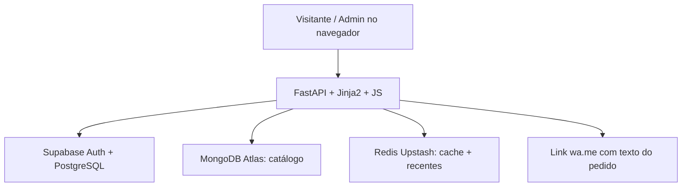

# 02 — Arquitetura de software

## Estilo
**Monólito modular Python-first:** FastAPI serve páginas Jinja2 e endpoints JSON. Tailwind é compilado para CSS estático; JavaScript controla carrinho, carrossel e `<model-viewer>`. Três bancos gerenciados têm responsabilidades distintas.



## Componentes
| Componente | Responsabilidade | Não deve fazer |
|---|---|---|
| Templates | Montar HTML e UI | Acessar bancos, confiar em preços do navegador |
| Frontend JS | Interações, carrinho local e 3D | Possuir chaves de banco, autorizar admin |
| API pública | Consulta, recente, checkout | Retornar campos internos/segredos |
| API admin | Autenticação, autorização, CRUD | Permitir acesso apenas por ocultar botão |
| Serviço de catálogo | Validar/normalizar produtos, índices/queries | Construir HTML |
| Serviço de checkout | Reconsultar produtos/preços/estoque e URL | Marcar pagamento como concluído |
| Adapters DB | Abstrair Supabase/MongoDB/Redis | Conter lógica de UI |

## Fluxos
### Cliente — catálogo
`GET /` → destaque MongoDB → render Jinja2 → `GET /api/products` para filtros, quando necessário → detalhe → Redis para recente. Redis retorna IDs; produtos completos vêm do MongoDB ou de cache com TTL.

### Admin — cadastro e atualização imediata
`/admin/login` → Supabase Auth → token/cookie seguro → checagem `admin_profiles.is_active` → `POST /api/admin/products` → MongoDB → invalidação Redis → catálogo renderiza a nova versão na próxima consulta, sem ISR/cache de HTML estático.

### Cliente — checkout
Carrinho guarda somente `{productId, sizeBR, quantity}` no browser (localStorage com esquema validado, ou memória). `POST /api/checkout` revalida produtos ativos, preço e estoque no MongoDB, retorna `waUrl` e resumo do servidor. O navegador abre `waUrl`. Não se registra pedido confirmado.

## Estrutura prevista
```text
neox-drop/
├── app/
│   ├── main.py
│   ├── core/{config.py,security.py,exceptions.py}
│   ├── api/{auth.py,products.py,recent.py,checkout.py,admin_products.py}
│   ├── services/{catalog.py,recent.py,cart.py,admin.py}
│   ├── db/{supabase.py,mongodb.py,redis.py}
│   ├── schemas/{product.py,checkout.py,auth.py}
│   ├── templates/{base.html,home.html,catalog.html,product.html,admin/}
│   └── static/{css/,js/,images/,models/}
├── supabase/migrations/
├── scripts/{seed_products.py,check_connections.py}
├── tests/{unit/,integration/,e2e/}
├── docs/
├── AGENTS.md
├── CLAUDE.md
├── .env.example
├── pyproject.toml
├── package.json
└── README.md
```
A estrutura é **planejada**, não evidencia arquivos de código já existentes.

## Decisões de implementação
- FastAPI com routers separados (`/api` público e `/api/admin`).
- Jinja2 para HTML inicial com carregamento progressivo; não introduzir SPA/React sem necessidade.
- `pymongo.AsyncMongoClient` para consultas assíncronas (ou driver síncrono isolado caso a equipe prefira simplicidade e demonstre ausência de bloqueio).
- `upstash-redis` sobre REST para facilitar função serverless; instância Redis exclusivamente do backend.
- `supabase-py` para auth e consultas SQL via API Supabase; evitar compartilhar sessão mutável de usuário entre requisições.
- `<model-viewer>` para 3D; `GLB` como recurso estático **licensed**; caso o modelo não exista, imagem 2D.
- API usa Pydantic para validação; Tailwind compilado no build (não depender do CDN de desenvolvimento).
- Configurações operacionais por variáveis de ambiente; não armazenar segredos no Git.

## Restrições e trade-offs
- Usar três bancos aumenta pontos de falha. Mantenha Redis como recurso auxiliar (fail-open para catálogo).
- Páginas renderizadas no servidor simplificam Python-first, mas transições e 3D exigem JS específico.
- Hospedagem serverless exige atenção a tempo de inicialização, tamanho dos assets, conexão MongoDB e lista de IPs do Atlas.
- Mudança de produto no carrossel: estados visuais devem ser sincronizados em uma única estrutura no frontend (não buscar cada campo separadamente).

## Referências oficiais
FastAPI templates: https://fastapi.tiangolo.com/advanced/templates/  
PyMongo Async: https://www.mongodb.com/docs/languages/python/pymongo-driver/current/  
Upstash Python SDK: https://upstash.com/docs/redis/sdks/py/overview/  
Model Viewer: https://modelviewer.dev/docs/  
Vercel FastAPI: https://vercel.com/docs/frameworks/backend/fastapi
