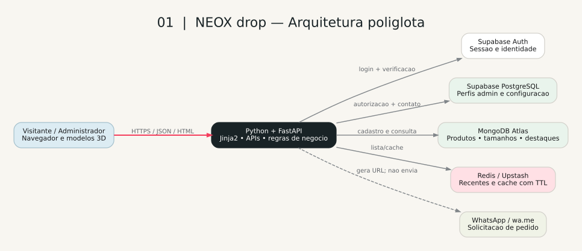
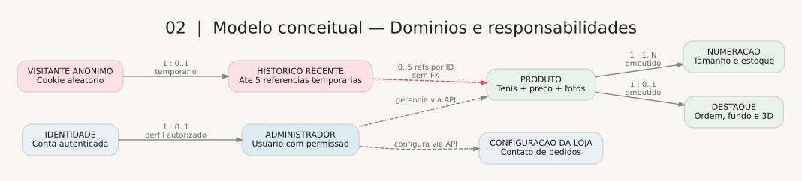
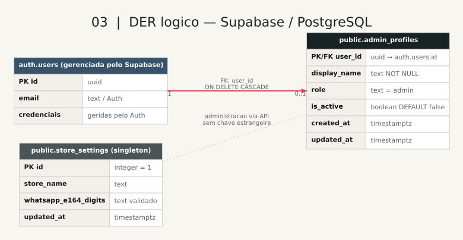
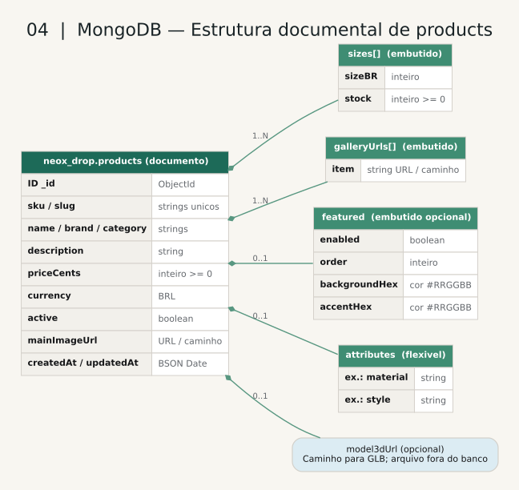
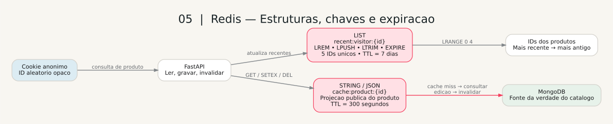
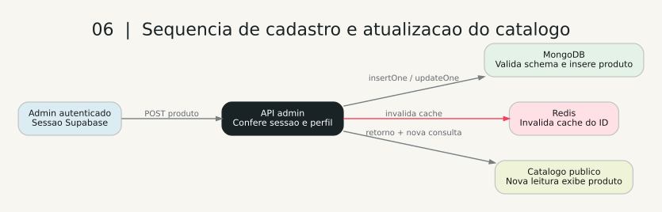
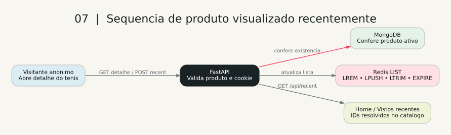
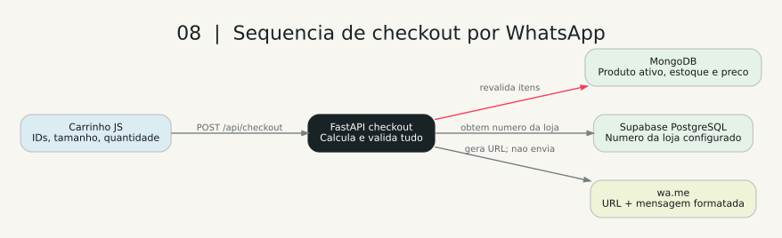
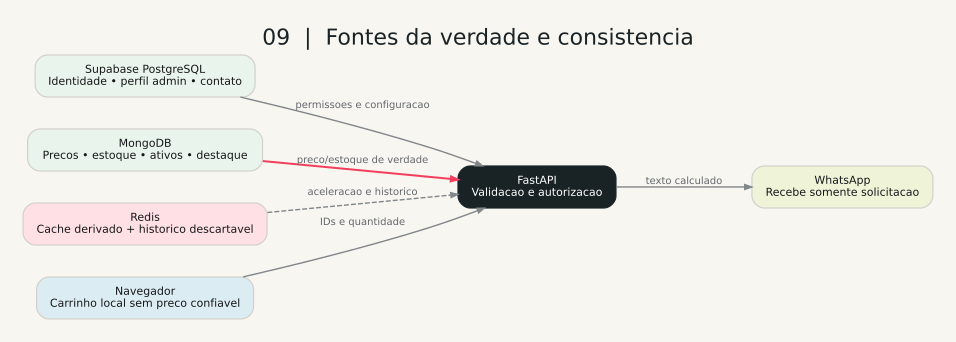

# 15 — Diagramas oficiais da NEOX drop (V1.1)

**Status:** especificação / diagramas propostos, ainda não evidências de banco implantado.  
**Notação:** DER para PostgreSQL; estrutura documental para MongoDB; chaves/TTL para Redis; sequência para processos.  
**Formato:** cada diagrama possui SVG vetorial, PNG de apresentação, código DOT e versão Mermaid editável em `docs/diagramas/mermaid/`.

> **Interpretação importante:** linhas tracejadas entre tecnologias representam referências lógicas ou chamadas à aplicação, **não** chaves estrangeiras entre bancos. Os diagramas são projeções do modelo a ser implementado.

**[Abrir o caderno técnico em PDF](../NEOX_drop_Caderno_Tecnico_Diagramas_V1_1.pdf)** (versão para apresentação, com 9 desenhos).

## 01. Arquitetura poliglota

**Objetivo:** distinguir frontend, API Python, Auth, PostgreSQL, MongoDB, Redis e checkout externo. Credenciais dos bancos permanecem exclusivamente no backend.

## 02. Modelo conceitual

**Objetivo:** identificar entidades de negócio, relações e responsabilidades sem transformar os três bancos em um único esquema relacional.

## 03. DER lógico do Supabase / PostgreSQL

**Regra de cardinalidade:** um registro de `auth.users` pode ter zero ou um registro em `admin_profiles`; cada perfil tem exatamente um usuário; `store_settings` contém uma única configuração de loja, sem FK para um admin. Relação de administração é uma **regra de autorização**, não relação física.

## 04. Modelo documental MongoDB

**Regra:** `sizes[]`, `galleryUrls[]`, `featured` e `attributes` são partes do documento `products`, **não** coleções/tabelas independentes. O arquivo GLB vive no armazenamento de mídia; o documento guarda somente sua URL/caminho.

## 05. Modelo Redis — chaves e expiração

**Regra:** lista de últimos cinco IDs, sem duplicações (TTL móvel de 7 dias), e cache opcional de detalhe público (TTL de 300 s) invalidado nas atualizações.

## 06. Sequência — cadastro e atualização imediata

*Visual resumido.* A sequência UML editável, incluindo a autenticação Supabase, está em [`06-sequencia-cadastro.mmd`](diagramas/mermaid/06-sequencia-cadastro.mmd).

## 07. Sequência — histórico de visualizações

*Visual resumido.* A sequência UML editável está em [`07-sequencia-recentes.mmd`](diagramas/mermaid/07-sequencia-recentes.mmd).

## 08. Sequência — checkout WhatsApp

*Visual resumido.* O checkout recalcula preços e verifica estoque **no MongoDB**, consulta o contato da loja **no Supabase** e apenas abre uma solicitação externa; não grava um pedido confirmado. Diagrama UML editável: [`08-sequencia-checkout.mmd`](diagramas/mermaid/08-sequencia-checkout.mmd).

## 09. Fontes da verdade e consistência

**Objetivo:** distinguir dados autoritativos (PostgreSQL para auth/perfis/contato; MongoDB para catálogo/preços/estoque) de dados derivados e descartáveis (Redis). O carrinho no navegador não é fonte confiável de preços.

## Como editar
- **GitHub:** Mermaid pode ser incluído diretamente em blocos `mermaid` em Markdown.
- **VS Code:** abrir os `.mmd` com extensão de prévia Mermaid, ou os `.dot` em extensão Graphviz.
- **Canva/slides/documentos:** utilizar SVG para qualidade vetorial ou PNG para compatibilidade.
- **Se o desenho mudar:** atualizar código Mermaid/DOT, imagens exportadas, dicionário e contratos de API no mesmo commit.

## Regras para apresentação
1. Apresentar primeiro o conceitual, depois o DER relacional e o modelo de documentos; por último, Redis e sequências.
2. Não afirmar que o sistema foi implementado apenas porque o diagrama existe.
3. Demonstrar uma gravação real em MongoDB, autenticação no Supabase e histórico real em Redis no vídeo da avaliação.
